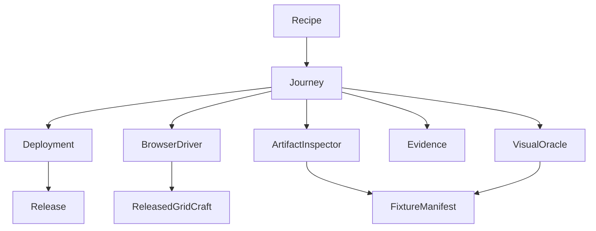
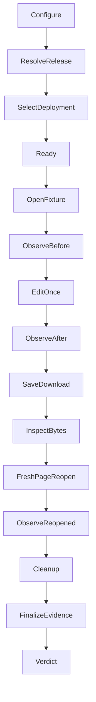

# Browser verification design

## Overview

CraftReport evaluators receive a reproducible Python journey that edits the
GridCraft workbook they can see, captures its real XLSX download, checks its
content and reopens those exact bytes. A machine-readable evidence packet keeps
browser effects, file checks, recordings and cleanup separate.

Requirements were approved by the owner on 2026-10-14. This Design proposes
implementation boundaries and budgets for review; it does not claim browser
feasibility has passed or authorize implementation. Full discovery found a
canvas UI and an important Save-profile limitation, described below.

### Goals

- Establish one released-browser edit, chart-preservation and file round trip.
- Make the same assertions in visible local review and unattended execution.
- Detect disconnected actions, preserve failures and shut down owned resources.
- Deliver an adaptable executable example and feature quickstart.

### Non-Goals

Live scheduling, producer ingestion, report compilation, a production app driver,
kernel-to-browser integration, financial assurance, WOPI and other Craft apps.

## Boundary Commitments

### This Spec Owns

- Development-only release acquisition, deployment selection and browser journey.
- Typed local interaction contracts, synthetic fixture expectations and evidence.
- Saved-file inspection, fresh-page reopen, negative challenge and cleanup.
- Its executable Python recipe, regression stage and user guide.

### Out of Boundary

No production package or operation is added to `src/craftreport` or `packages`.
The operation kernel remains unchanged. This harness is not a second reporting
facade, reusable browser automation framework, XLSX engine or plugin runtime.
The current probe at port 8871 remains owned by its existing project.

### Allowed Dependencies

The harness uses Python standard libraries, existing Pydantic/HTTPX/packaging,
pinned Playwright Python and Pillow. It consumes an official GridCraft archive
and Docker Compose through subprocess argument arrays. No sibling-repository
imports, private packs, AI services, Rust build tools or database are required.
The production wheel excludes the harness. Production code must not import it;
the harness must not import production adapters, interfaces or composition.

### Revalidation Triggers

App asset hash, browser revision, OS/graphics profile, selectors/geometry, file
route, fixture expectations, visual baseline, artifact inspector, evidence schema
and ownership changes invalidate affected acceptance. A later production adapter
must prove its own integration; this packet cannot transfer success to it.

## Architecture

### Existing Architecture Analysis

The operation kernel has synthetic REST/MCP validation. The separate nginx probe
proves app rendering, not edit/save/reopen. The sibling Playwright flow supplies
useful lifecycle practices, not a runtime dependency. Existing fast checks cover
all scripts/tests; the import gate currently covers only source/packages.

### Architecture Pattern and Boundary Map

Use a small procedural coordinator with typed state, cohesive external adapters
and pure expectation comparison. Only the browser driver owns app interaction.



Import direction is values/configuration -> release/deployment, browser driver,
artifact/visual inspection and evidence -> journey -> recipe. Sibling external
adapters do not call each other; Journey passes typed results. Fixture expectations
are inputs to independent checks, never populated from the observed result.

### Technology Stack

| Layer | Choice / version | Role and boundary |
| --- | --- | --- |
| Python | Existing >=3.12,<3.13; validation baseline 3.12.10 | Strict typed development tooling |
| Browser automation | Playwright Python 1.64.0 | New exact dev dependency; install its matching Chromium revision |
| Image comparison | Pillow 12.3.0 | New exact dev dependency; small fixed-region visual checks |
| Validation / HTTP | Existing locked Pydantic and HTTPX | Config/manifest codecs and release downloads |
| XLSX inspection | `zipfile`, `xml.etree.ElementTree` | Bounded fixture-only OOXML inspection; no recalculation |
| Fixture authoring | XlsxWriter 3.2.9, one-time fixture preparation | Retain static fixture and provenance; no runtime writer dependency |
| App | Latest official release, minimum 0.6.1 | Resolve then freeze archive/build hashes per run |
| Static hosting | Existing nginx image digest from docs recipe | Owned Compose service or explicit external origin |

Exact dependency resolution and platform installation are implementation checks.
Do not silently substitute system Chrome for the pinned Chromium build.

## File Structure Plan

All paths below are planned; new runtime files are created only after Tasks approval.

| Component | New paths | Single responsibility |
| --- | --- | --- |
| Values | `scripts/browser_verification/__init__.py`, `contracts.py`, `config.py` | Package marker, typed outcomes/identities, validated CLI configuration |
| Release | `scripts/browser_verification/release.py` | Official release selection, bounded download/checksum and safe extraction |
| Deployment | `scripts/browser_verification/deployment.py` | Owned Compose or external deployment lifecycle |
| BrowserDriver | `scripts/browser_verification/browser.py`, `interactions.py` | Context/page lifecycle; release-profile UI actions and fresh readback |
| ArtifactInspector | `scripts/browser_verification/xlsx.py` | Read-only fixture-specific OOXML comparison |
| VisualOracle | `scripts/browser_verification/visual.py` | Profile-bound chart/range/presentation observations |
| Evidence | `scripts/browser_verification/evidence.py` | Sanitized findings, hashes, screenshots/video manifest and final verdict |
| Journey | `scripts/browser_verification/journey.py` | Ordered stages and unconditional cleanup |
| Recipe | `scripts/examples/verify_gridcraft_browser.py` | Public CLI calling the same Journey |
| FixtureManifest | `tests/fixtures/browser_verification/reference.xlsx`, `expected.json`, `README.md`, `visual/manifest.json` | Known workbook, independent expectations, provenance and reviewed visual-profile metadata |
| Visual baselines | `tests/fixtures/browser_verification/visual/<profile>/<checkpoint>.png` | Reviewed, immutable synthetic reference crops |
| Regression tests | `tests/browser_verification/test_contracts.py`, `test_artifacts.py`, `test_lifecycle.py`, `test_journey.py` | Boundary/fault cases and actual browser journeys |
| Hosted stage | `.github/workflows/browser.yml` | Dedicated browser CI stage with retained failure evidence |
| Guide | `docs/quickstarts/Quickstart_How_to_verify_GridCraft_in_a_browser.md` | Prerequisites, recipe, observations, limitations and cleanup |

`contracts.py` and other abbreviated paths in the first table row are within
`scripts/browser_verification/`. No new deploy tree is needed: Deployment uses
the existing `docs/deployment/gridcraft/compose.yaml` and `nginx.conf`, with an
explicit unique project name, absolute verified mount and selected port.

Modified paths:

- `pyproject.toml`, `uv.lock`: exact dev dependencies and browser test marker.
- `scripts/check.py`: explicit `--browser` mode, preserving kernel integration.
- `scripts/check_imports.py`, `tests/engineering/test_boundary_gates.py`: targeted
  harness import-direction and production isolation checks.
- `breadth.toml`, `quality.toml`: reviewed owner activation and budget scope.
- `docs/examples.md`, `docs/quickstarts/index.md`, `docs/gridcraft-setup.md`,
  `docs/roadmap.md`: entry points, tested profile and readiness updates.
- This spec's metadata, Tasks and validation record: phase/evidence authority.

### Proposed Ownership and Budgets

Propose `capability.browser-verification`, kind `tooling`, line
`quality-verification`, most-specific owners `scripts/browser_verification`,
`scripts/examples/verify_gridcraft_browser.py`, `tests/browser_verification` and
`tests/fixtures/browser_verification`. These remain proposals until Design approval.
Register before code expansion. Existing development-gates owns shared gate/CI
changes; documentation owns guides. No movement of existing code resets a budget.

Apply 50 function LLOC, 300 module LLOC and McCabe 10. The owner approved a
browser-only 2,800 aggregate source-LLOC cap on 2026-10-14 after independent
calibration; all other capabilities retain their 1,500 default. Count every
owned helper and recipe once in source; tests remain separately reported. No
waiver or relocation resets ownership. The new gate task must enforce the exact
numeric override before further browser expansion.

| Responsibility | Completed planning LLOC |
| --- | ---: |
| Values/configuration/resource registry | 314 |
| Fixture records and bounded OOXML inspector | 409 |
| Official release acquisition | 220 |
| Deployment | 250 |
| Browser startup/lifecycle | 240 |
| Real UI interactions/readback/download | 290 |
| Visual profiles and comparisons | 220 |
| Evidence/finalization | 280 |
| Additional Journey orchestration/cleanup | 210 |
| Adopter CLI | 60 |
| **Target total** | **2,493** |

These are aggregate estimates, not separate allowances. Existing Journey 61 is
included in the foundation subtotal; its planned completed module is 271.
Measured accepted source through task 2.2 is 1,195. The remaining work is
estimated at 2,300–2,750 whole-capability LLOC; canvas and lifecycle calibration
are uncertainties. Reuse existing values and the same observation/Journey paths
without weakening mandatory checks. Any further cap change requires review.
See [the approved calibration amendment](budget-amendment.md) for provenance,
owner decision, typed enforcement and required boundary regressions.

## System Flows



Every stage can fail or become unresolved; all acquired resources still enter
Cleanup. A stage failure leaves dependent stages `unexecuted`. No automatic edit
or Save retry follows possible interaction. Recovery is a new run with a link to
the retained failed run. Cancellation uses the same cleanup/finalization path.

## Requirements Traceability

| Requirement | Summary | Components | Interfaces | Flows |
| --- | --- | --- | --- | --- |
| 1.1, 1.2, 1.3 | Official latest archive and trust | Release | resolve/acquire | Preparation |
| 1.4, 1.5, 1.6 | Actual build and usable controls | Deployment, BrowserDriver | prepare/open | Readiness |
| 2.1, 2.2, 2.3 | Owned or external target | Values, Deployment | RunConfig/DeploymentLease | Preparation/cleanup |
| 2.4, 2.5, 2.6 | Exact isolated page/document | BrowserDriver | TargetIdentity/observe | Every interaction |
| 3.1, 3.2, 3.3 | Known fixture and real edit | BrowserDriver, FixtureManifest | open/edit/observe | Before/after |
| 3.4 | Sentinels and live chart bindings | BrowserDriver, VisualOracle | observe/chart checks | Before/after/reopen |
| 3.5, 3.6, 3.7 | Visible and unattended profiles | BrowserDriver, Journey | profile/capabilities | Readiness/journey |
| 4.1, 4.2, 4.3, 4.4 | Real save and destination protection | BrowserDriver, Journey | save/ArtifactIdentity | Download |
| 4.5, 4.6, 4.7 | Semantic bytes and exact reopen | ArtifactInspector, BrowserDriver | inspect/open | Inspect/reopen |
| 5.1, 5.2, 5.3 | Identity, screenshots and final videos | Evidence | capture/finalize | All checkpoints |
| 5.4, 5.5, 5.6 | Diagnostics and distinct findings | Evidence, Journey | StageFinding | All stages/verdict |
| 6.1, 6.2 | Bounds and unresolved actions | Values, Journey | RunConfig/StageFinding | Timeout |
| 6.3, 6.4, 6.5 | Disconnection and recovery | Journey, BrowserDriver | challenge/run | Separate attempts |
| 6.6 | Missing prerequisites | Journey | blocked finding | Preparation/any stage |
| 7.1, 7.2, 7.3 | Owned cleanup including failure | Deployment, BrowserDriver, Evidence | close/finalize | Cleanup |
| 7.4, 7.5 | Honest scoped verdict | Evidence | RunResult | Finalization |
| 8.1, 8.2, 8.3 | Runnable recipe and guide | Recipe, Journey | CLI | Same full journey |
| 8.4, 8.5, 8.6 | Benefit, repetition and limitations | Recipe, Evidence | CLI/packet | Adopter and CI |

## Components and Interfaces

All returned values are immutable typed records validated at JSON boundaries;
errors use `StageFinding`, never exceptions serialized as an implicit success.
Adapter calls return `Outcome[T] = Succeeded[T] | Rejected`, discriminated by
`status`; success carries the named payload and rejection carries a non-passing
StageFinding. Signatures below show their success payload T for readability;
each adapter's actual return type is Outcome[T]. Journey.run returns RunResult
for every handled outcome. External failures are caught at their owning adapter,
sanitized and handed to Journey. Resources acquired before a rejection remain
registered for cleanup; a rejected result cannot discard ownership.

### Release and Deployment

**Contracts:** Service and State. Coverage: 1.1, 1.2, 1.3, 1.4, 2.1, 2.2, 2.3,
7.1, 7.2, 7.3. Inbound Journey (P0); external GitHub and Docker (P0).

- `resolve_release(config: RunConfig) -> ReleaseIdentity`: fetch latest official
  non-draft stable release metadata; require minimum version and a unique web
  asset. Save metadata, acquisition time and asset digest. Never label a cached
  older release latest after a failed lookup. Missing publisher digest requires
  an explicit trusted expected digest plus provenance; trust cannot be derived
  from the just-downloaded bytes alone.
- `acquire(release: ReleaseIdentity, root: Path) -> BundleIdentity`: verify digest
  on cache reuse too; enforce archive size/path bounds, reject symlinks/traversal,
  retain HTML/JS/WASM file hashes. No build step. Reuse cache as immutable input.
- `prepare(config: RunConfig, bundle: BundleIdentity) -> DeploymentLease`:
  owned mode invokes Linux Docker directly or `wsl.exe -d Debian -- docker`
  with Linux paths; uses unique project, labels and available configured port.
  Never use 8871. Existing-project/container conflict stops startup. No container
  adoption. External mode receives an explicit origin/build manifest and never
  invokes Compose up/down. Verify actual loaded HTML/JS/WASM against expected
  hashes, including browser responses with cache disabled; claimed version text
  alone is insufficient. External inaccessible assets remain unverified.
- `close(lease: DeploymentLease, bound: float) -> CleanupFinding`: close only
  resources recorded as acquired; preserve externally owned services and files.
  Inspect owned IDs/labels before removal; verify no owned container remains.
  Cleanup never recursively deletes retained evidence or shared cache.

Record bind address separately from browser origin. Local defaults bind loopback;
explicit `0.0.0.0` is supported for operator-requested LAN hosting. Origin must be
a browser-reachable host. Chromium clipboard requires a secure context: localhost
or HTTPS. A remote plain-HTTP LAN target lacking required capabilities is blocked,
not silently promoted to a different origin or browser security bypass.

### BrowserDriver

**Contracts:** Service and State. Coverage: 1.5, 1.6, 2.4, 2.5, 2.6, 3.1, 3.2,
3.3, 3.4, 3.5, 3.6, 3.7, 4.1, 4.2, 4.3, 4.6, 6.2. Inbound Journey (P0);
external released GridCraft and Playwright (P0); VisualOracle (P0 via Journey).

Use one owned Chromium process, isolated recording contexts and a fixed viewport,
locale, device scale and graphics profile. The recipe defaults to headed; CI
explicitly requests headless. Failure to launch visibly cannot fall back silently.
Record browser executable revision, OS, graphics backend and actual visibility.

The selected initial profile is **chromium-download-fallback**. Before app code
runs, a disclosed init script removes only `window.showSaveFilePicker` if it is
present and configurable. Verify the property is absent; otherwise block. Record
the initial capability and override in the packet. This exercises the unchanged
released application's existing download branch. It does not stub Save, inject
workbook values or manufacture bytes. It proves this controlled profile only;
native Save-picker and default Chrome behavior remain explicitly unverified.
No engine globals, hidden command API or headless MCP are injected or used.

`open(fixture: ArtifactIdentity) -> TargetIdentity` arms `expect_file_chooser`,
invokes the app's Open UI and supplies the exact fixture. The driver verifies
the marker and known cells after loading. Controls inside egui are not assumed
to be DOM nodes: use observed accessibility locators when real, otherwise a
version/profile-bound canvas geometry map. No unverified coordinate action counts
as a result. Geometry is calibrated against visible headers/controls in the
first feasibility slice; unsupported layout or release changes block the profile.

`observe(target: TargetIdentity, checks: ObservationSpec) -> BrowserObservation`
rechecks origin, page/generation, loaded asset set and document marker before
mutation. Use actual Name Box reference navigation and real UI Copy, with
origin-scoped clipboard permissions. Seed clipboard with a unique nonce before
each copy; poll for a distinct fresh value and compare known expected content.
Record selected reference independently through the Name Box text-copy path and
selected-cell screenshot. Clipboard alone does not prove storage type: exact
numeric/string types are independently checked in the saved artifact.

`edit(target: TargetIdentity, edit: CellEdit) -> ActionReceipt` navigates to the
known cell, edits through the actual formula bar and commits Enter once. Receipt
is pending until fresh observation confirms the expected value and sentinels.
Name-box/formula-bar egui IDs are not CSS selectors. App document title/fixture
marker and generation are checked around actions; unexpected navigation, popup,
asset or marker changes stop mutation. Harness IDs are associations, not claimed
native engine revision numbers.

`save(target: TargetIdentity, destination: Path) -> ArtifactIdentity` arms
`expect_download` before invoking app Save. Require a successful download with
readable bytes. Copy to a new exclusively created run-owned destination and hash
it before closing context; never trust the suggested filename as a path. An
existing destination is a conflict; this recipe has no overwrite mode. Native
picker appearance, cancel, no download or timeout remains failed/unverified.
The save-complete screenshot records the app checkpoint, not proof of disk bytes.

Reopen creates a fresh page in a fresh isolated context under the same profile,
loads precisely the retained artifact hash, increments generation and repeats
the same observation checks. No reuse of the first page's workbook state.

### ArtifactInspector and VisualOracle

**Contracts:** Service. Coverage: 3.1, 3.3, 3.4, 4.5, 4.6, 4.7. Inbound Journey
(P0); external OOXML ZIP/XML and rendered pixels (P0).

`inspect(artifact: ArtifactIdentity, expected: FixtureExpectation) -> CheckSet`
reads bytes without rewriting them. Follow workbook/sheet/drawing/chart/style
relationships rather than assuming `sheet1.xml` or `chart1.xml`. Accept equivalent
inline/shared strings and normalized references; compare semantics, not ZIP
ordering, relationship IDs or exact workbook bytes. Bound ZIP member count and
expanded size; reject duplicate paths, traversal, external relationships and DTDs.
This is a small known-fixture inspector, not a general Excel validator.

Fixture: one sheet `Report`; A1=`Period`, B1=`Value`; A2:A4=`Q1,Q2,Q3`;
B2:B4 numeric `10,20,30`; D1=`craftreport-browser-reference-v1`;
D2 string `KEEP`; D3 numeric `-7`. Edit B3 from numeric 20 to 25. One line chart
at F2 has literal title `Reference series`, literal series name `Value`, categories
`Report!$A$2:$A$4` and values `Report!$B$2:$B$4`. No formulas/macros/external links.
Presentation checks: bold header, integer number format and chart type/title,
legend and visible placement. Fixture hash/provenance and expectations are
reviewed before executing the app; baseline output never defines correctness.

`compare_visual(observed: Path, profile: VisualProfile) -> CheckSet` verifies
profile-bound crops using Pillow. First implementation records the real canvas
geometry and independently reviewed reference crops. Thresholds, small excluded
caret regions and expected chart-range bounds are frozen in visual/manifest.json
before acceptance runs; an unknown profile cannot auto-update its baselines.
The initial profile uses a fixed viewport and scale; headed/headless use the same
semantic assertions, with separately reviewed OS/graphics baseline identities.

For live chart bindings, select the single chart and verify the blue values-range
outline against visible B2:B4 cell bounds. Open Select Data, copy the category
field and confirm the visible series name; cancel without changing chart state.
The released dialog has no values-reference editor. A blank overall source field
on an imported chart is allowed; it is not a substitute for the range outline.
Check the visible line plot before/after/reopen against reviewed crop expectations,
including the changed middle point. The manifest ties chart title/anchor, one
series and the source outline to the same chart. If this observation cannot be
made reliable, 3.4 remains blocked: saved OOXML alone cannot close the live check.

### Evidence and Journey

**Contracts:** Service and State. Coverage: 5.1, 5.2, 5.3, 5.4, 5.5, 5.6,
6.1, 6.2, 6.3, 6.4, 6.5, 6.6, 7.1, 7.2, 7.3, 7.4, 7.5.
Inbound Recipe/tests (P0); outbound all selected adapters (P0).

`run(config: RunConfig) -> RunResult` uses one resource registry from before
startup, registers each acquired resource immediately, and always finalizes.
Configured positive readiness/action/cleanup bounds are recorded; suggested CLI
defaults are 90/20/30 seconds, overridable, not a performance claim. Per-stage
deadlines include awaited effects; timeout after possible input is `unresolved`.

Diagnostics subscribe before navigation. Retain typed stage, event category,
sanitized message code and safe asset identity. Discard credentials, query strings,
raw arbitrary exception bodies and private page content. Unexpected page errors,
console errors and critical HTML/JS/WASM/file failures fail the affected stage.
Any warning allowlist is exact, justified, version-scoped and recorded; do not
ignore all WebGL or network findings. Only synthetic contexts are recorded.

`finalize(result: RunResult, resources: ResourceRegistry) -> RunResult` closes
contexts first, waits for video finalization, then closes browser/driver and owned
deployment. Verify required videos are nonempty, hashable and decodable by the
same pinned browser's video element in a separate unrecorded verification context;
record metadata duration and an actual decoded frame. Close that context too.
Retain primary failure and cleanup failure separately. Missing/undecodable video,
forced termination or surviving owned resources prevents verified acceptance.
Track directly owned process handles/container IDs, never kill by image name or
stale PID. Windows child process-group and Linux session ownership must be proven
in lifecycle tests; cancellation before/after acquisition follows the same path.

`VERIFIED` requires every mandatory stage/check and cleanup to pass. Other
verdicts are `FAILED`, `BLOCKED` or `UNRESOLVED`; none is a successful exit.
Missing startup prerequisites can have no recording, but their stages remain
unexecuted and never become a verified journey. A deliberately suppressed edit
is a test-only challenge: it must produce a FAILED journey packet with unchanged
B3, followed by a separate fully successful run with dispatch restored.

### Recipe

**Contracts:** Batch. Coverage: 8.1, 8.2, 8.3, 8.4, 8.5, 8.6. Inbound ordinary
operator/CI (P0); outbound Journey (P0). No AI prerequisite.

Planned invocation after implementation:

```text
uv.exe run --frozen python -m scripts.examples.verify_gridcraft_browser --deployment owned-wsl --headed
uv run --frozen python -m scripts.examples.verify_gridcraft_browser --deployment owned-linux --headless
uv run --frozen python -m scripts.examples.verify_gridcraft_browser --deployment external --origin https://host.example --build-manifest trusted-build.json --headed
uv run --frozen python scripts/check.py --browser
```

The URL/build manifest in the external example are operator-supplied placeholders.
Default recipe duration is bounded by stage deadlines and a configured short
headed review dwell; no endless process is left behind. Emit evidence directory,
scoped verdict and nonzero status for unmet prerequisites/effects. The test-only
disconnection option is not an adopter feature. The guide explains the fallback
profile and visibility prerequisites next to these commands. Direct app MCP is
useful for its connected native/headless engine; this workflow adds repeatable
proof about a selected browser workbook and its file boundary. It is not yet the
reporting facade's live dashboard or reporting export capability.

## Data Models

### Domain and Logical Model

| Record | Required fields and invariants |
| --- | --- |
| RunConfig | run UUID, deployment discriminated union, headed flag, profile ID, bounds, unique output root, trusted release/build expectations |
| Outcome[T] | Values owns tagged Succeeded[T] with payload T, or Rejected with failed/blocked/unresolved StageFinding; no success payload on rejection |
| ReleaseIdentity / BundleIdentity | version, release/asset URL and ID, expected/observed SHA256, trust source, extracted file hashes |
| DeploymentLease | owned/external, origin, bind address, project/container IDs if owned, actual loaded build hash |
| TargetIdentity | run/context/page IDs, page generation, origin, browser mode/build, fixture marker, opened artifact hash; no invented engine revision |
| CellEdit | address, typed expected before/after, target identity, one dispatch ID |
| ObservationSpec | Values owns expected target/marker, selected addresses, expected values, chart identity, visual profile and checkpoint; supplied by reviewed FixtureExpectation |
| ActionReceipt | Values owns dispatch ID, target, action, monotonic start/deadline, pending/observed/unresolved status and observation references; pending alone never closes an effect check |
| BrowserObservation | selected reference, fresh clipboard values, marker/sentinels, chart/range checks, screenshot references |
| FixtureExpectation | FixtureManifest owns schema version, input hash, before/after typed cells, sentinels, literal chart identity/title/series, category/value references and presentation checks; immutable before execution |
| VisualProfile | FixtureManifest owns app/browser/OS/graphics/viewport/scale identity, calibrated canvas control/cell bounds, crop and baseline hashes, masks and fixed comparison thresholds; unknown identity blocks comparison |
| CheckSet | Values owns ordered expected/observed assertions, requirement IDs, evidence refs and pass/fail/unexecuted per assertion; aggregate passes only if every mandatory assertion passes |
| ResourceRegistry | Journey owns ordered acquisition tokens, resource kind, owner run, exact handle or container/context identity, acquisition state and close state; register immediately, close reverse dependency order, retain partial-start resources |
| ArtifactIdentity | exclusive destination, size, SHA256, run/target generation, download route |
| StageFinding | stage, numeric requirement IDs, status pending/passed/failed/blocked/unresolved/unexecuted, expected/observed safe values, evidence refs |
| CleanupFinding | resource identity and owner, graceful/forced/unexecuted, exit status, survivors, final video state |
| RunResult | schema version 1, source revision plus dirty content manifest, dependency/app/profile identities, ordered findings, cleanup, verdict, predecessor run |

Run directories are append-only identities under ignored
`artifacts/browser-verification/<run-id>/`: `manifest.json`, `findings.json`,
sanitized diagnostics, screenshots, videos, fixture and `output/result.xlsx`.
Final manifest is atomically written after cleanup with all referenced hashes;
an interrupted partial manifest is never accepted. Failed and recovered runs have
different directories. No database or shared mutable workbook cache is introduced.

## Error Handling

Reject invalid config, unavailable tools, untrusted builds, occupied targets and
unsupported profiles before mutation. Keep action timeout uncertainty distinct
from known rejection. Never retry Save to resolve ambiguity. Cleanup errors do
not replace the original finding. A public result is always scope-specific and
does not claim live updates, durable reporting storage or financial validation.

## Testing Strategy

The first implementation slice is the real feasibility journey. It must prove
open, fresh clipboard readback, edit, live chart-range observation, actual download
and fresh-page reopen on the selected release/profile before broad harness or
downstream integration expansion. If any route is unavailable, preserve the
failure and return for a scoped design/requirements decision, not a fake pass.

- **Fast contracts:** invalid checksum/version/path, destination conflict, target
  generation change, missing stage/video, timeout/unresolved classification and
  verdict reduction (1.2, 1.3, 2.5, 4.4, 5.5, 6.2, 7.4).
- **Independent artifacts:** corrupt marker/type/sentinel/chart relation/formula
  and presentation in actual ZIP fixtures; prove inspector rejects each material
  mismatch. Reject missing chart and external relationships (4.5, 4.7).
- **Lifecycle integration:** real owned subprocess startup failure/cancellation,
  graceful versus forced cleanup, unrelated-service preservation, video truncation
  and failed finalization; missing tools cannot skip into success (5.3, 6.6, 7.1,
  7.2, 7.3).
- **Real browser:** complete headed and unattended reference journey; checkpoint
  screenshots, finalized success/failure video, saved byte inspection and exact
  fresh-page reopen. Known-before and changed-after values must differ (3.1,
  3.3, 3.4, 3.5, 3.6, 4.1, 4.2, 4.6, 5.2).
- **Sensitivity/recovery:** suppress only edit dispatch in disposable test mode;
  unchanged B3 fails fresh effect assertion. Restore wiring in a distinct run and
  pass the whole journey. Retain both; also test no-download timeout and actual
  destination conflict without overwriting content (4.3, 4.4, 6.3, 6.4, 6.5).
- **Adopter reproduction:** run the actual Python recipe from a clean checkout,
  follow the quickstart, inspect evidence, verify no sibling dependency and owned
  cleanup. Same Journey is used by CI (8.1, 8.2, 8.3, 8.4, 8.5, 8.6).

Canonical fast and kernel integration commands remain as documented. Proposed
`--browser` runs the browser stage separately, with actual-browser tests marked
`integration` and `browser` so pre-commit never silently starts a browser.
Browser CI installs pinned Chromium/system dependencies, serves the official
archive, runs the same journey, uploads evidence even on failure and exits nonzero
when required coverage is unavailable. Hosted CI success must be observed, not
inferred from its workflow file. No load benchmark is promised by this scope.

## Interaction and Verification Contract

Canonical expectations belong to the reviewed fixture manifest. Mutable workbook
state belongs to the identified browser page. Saved bytes belong to an exclusively
created artifact path; the inspector never fixes them. Screenshots and evidence
are observations, not the authoritative workbook. Source/input/build identities
bind all four without asserting a hidden cross-engine transaction.

Every Open/edit/copy/Save/reopen action has a typed target, prerequisites, bounded
single dispatch and observed postcondition. Pending acknowledgement cannot become
success without the respective effect. A repeated run receives a new identity;
replaying an unresolved action in place is forbidden. Cleanup is mandatory for
the verdict. The highest-risk case is an apparently accepted edit or Save with no
matching visible/file effect; the disconnected-action and missing-download cases
must fail independently of receipts and screenshots.

Design approval will approve this explicitly controlled fallback profile and the
new 1,500-LLOC tooling capability, not native-picker support or implementation
completion. Tasks approval remains separate. Existing fast/kernel checks are
available; browser code, baselines, fixture, CI job, executable recipe and guide
are planned and unimplemented at Design generation.
