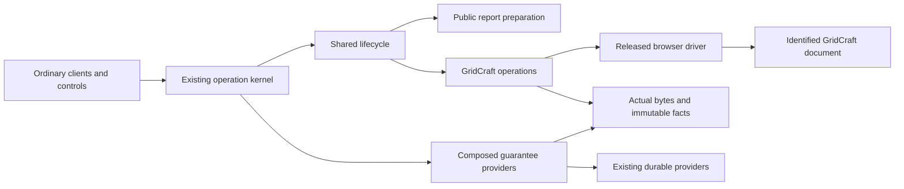

# Design Document

## Overview

The installed GridCraft package connects the existing guarded facade, accepted snapshot/runtime contracts and immutable prepared reports to one released browser document. The first product slice binds a small fixed layout, updates its values through actual browser input, displays lifecycle/freshness in a companion control panel, and obtains actual app-emitted XLSX bytes for independent inspection and fresh GridCraft reopen.

This is a gated integration Design. The released v0.7.0 bridge supports initial open and outbound save, not live cell commands, queries, save triggers or document acknowledgements. A bounded real feasibility task must prove the selected route before production expansion. Failure retains untested/unavailable status and returns the route to Design; it does not authorize a different engine, another workbook per refresh or a library-generated export. Independent phase review remains required under the bounded overnight authority.

### Goals

- One same-document table/line-chart journey with ordinary clients and AI disabled.
- Honest scoped support, target conflicts, snapshot-pinned artifacts and trusted evidence.
- Minimal composition using mature libraries and existing kernel/runtime owners.

### Non-Goals

No alternative scheduler, compiler, journal, generic browser framework, finance/GIPS evaluator, native driver, arbitrary existing-workbook migration or other app. No GridCraft compilation.

## Boundary Commitments

### This Spec Owns

- A separately installed `craftreport-gridcraft` distribution and `gridcraft.web_reports` capability: browser settings, typed operations, released-build driver, owned layout/style mapping, actual-file inspection and app evidence.
- App-owned document/artifact resource observations, local serialization and immutable external-effect manifests, composed through existing `GuaranteeProviders` ports.
- The companion control panel, app/runtime/report preparation collaborators, installed composition recipe and adopter guide/demo.

### Out of Boundary

Snapshot-runtime owns immutable snapshots, producer order/completeness, SQLite providers, run pins, cadence, lifecycle and reconciliation. Report-model/packs owns definition preparation, semantic roles, attribution/distribution scope and release decisions. The kernel remains the sole dispatcher, retry authority, operation journal and retained result authority. Browser verification owns acquisition/deployment/profile and evidence tooling; its fixture-specific driver is not production reporting code. No upstream table/schema or application-kernel change is planned.

### Allowed Dependencies

Inward app values depend on stdlib, `contracts`, `data.values`, `reporting.prepared`, `themes.values`, `policies.values` and runtime values. App orchestration alone imports exact existing application registry/codec/context/service/guard ports, `runtime.ports`, report operations and policy evaluation. Concrete Playwright, XlsxWriter and openpyxl imports remain in app driver/workbook modules. App composition imports existing `composition.settings`, `open_application` and concrete accepted upstream providers. Pure core modules never import this package. Shared engineering changes serialize through root.

Reuse existing browser release/deployment/evidence utilities in acceptance tooling by composition; production package never imports `scripts.browser_verification` or its fixture state. No broad SDK allowance is introduced into core. The companion panel uses existing public invoke/inspect/result endpoints; it has no business-operation server or second lifecycle loop.

### Revalidation Triggers

Release/bundle/browser/profile changes reopen driver and style/save feasibility. Snapshot scalar/prepared/RunPins/check-scope changes revalidate app mapping, manifest codecs and artifacts. Target marker/layout/generation, guard/resource routing, artifact visibility or evidence identity changes revalidate runtime recovery and installed clients. Changes to fixed-shape/precision/load support require admission and fidelity revalidation. The independent headed browser gate stays open until its own evidence exists.

## Architecture

### Existing Architecture Analysis

The kernel already supports installed entry points, frozen values, strict Pydantic codecs, guarded operation bindings, `OutcomeProposal`, `StageResult`, `EvidenceRef` and injected `GuaranteeProviders`. Current application source is 1,449/1,500 LLOC and receives no additions. Both reviewed upstream designs/tasks are frozen contract inputs; they do not establish implemented providers. Installed adopter acceptance waits for their accepted real provider tasks.

The existing verification driver is intentionally fixture-specific: fixed canvas geometry, one B3 edit and calibrated chart observations. Its latest recorded chart-before/category-copy failure remains unresolved. Source similarity or a screenshot cannot establish app-driver readiness.

### Technology Stack

| Layer | Choice / version | Role / constraint |
| --- | --- | --- |
| Package | CPython >=3.12,<3.13; existing Pydantic 2.14.1 | Frozen inward values, strict wire codecs, ordinary installed entry point |
| Browser | Playwright 1.64.0 and its recorded Chromium build | Headless unattended actual UI, isolated context, screenshots/video/diagnostics |
| App | Official downloaded GridCraft v0.7.0 web bundle | Archive SHA256 `ad10af2baf9c7ed4ccbd81e32b37698f5075cdf4f26b726fee7fc7938a3a8d27`; verify loaded JS/WASM identities |
| Bootstrap | XlsxWriter 3.2.9 | One initial workbook only; explicit text writes, no formula/URL conversion |
| Inspection | openpyxl 3.1.5, read-only use; bounded stdlib ZIP/XML inspection | Independent values/styles and chart references; never load/save to normalize output |
| Facts/artifacts | stdlib pathlib/os/hashlib/json | Configured app-owned directory, immutable bounded files and atomic read-back |
| UI/hosting | Small packaged HTML/JS; existing nginx/Compose static hosting | Same-origin iframe and proxy to existing facade; no UI framework |

Pin and verify these dependencies in the package/lock activation task; record transitive dependencies and installed-wheel compatibility. All dependency versions are selections, not claims of installed readiness. Current official library metadata supports Python 3.12. The acquired released bundle is reused; Debian WSL is only the Docker host, Windows runs development tests and headless browser automation.

## File Structure Plan

No empty scaffolding is created. New app source remains within its existing default 1,500 LLOC capability cap, <=300/module, <=50/function and McCabe<=10.

| Component | Paths | Responsibility / owner |
| --- | --- | --- |
| AppValues | `packages/craftreport-gridcraft/src/craftreport_gridcraft/values.py`, `codecs.py` | Frozen settings/target/layout/observation/artifact values and strict codecs; gridcraft |
| WorkbookMapping | `.../workbook.py` | Supported-shape admission, bootstrap and semantic presentation mapping; gridcraft |
| BrowserDriver | `.../browser.py`, `interactions.py` | Context identity, same-document real input/readback, official bridge lifecycle; gridcraft |
| ArtifactVerification | `.../artifacts.py` | Actual-byte capture/persistence, bounded read-only inspection and fresh browser reopen; gridcraft |
| AppFacts / AppProviders | `.../facts.py`, `providers.py` | Immutable external-effect facts, resource/evidence/guard routing; gridcraft |
| AppOperations | `.../operations.py`, `capability.py`, `__init__.py` | Operation bindings, capability factory/lifetime; gridcraft |
| AppComposition | `.../integration.py` | Real preparation/app runtime collaborators and provider composition, no business rules; gridcraft |
| ControlPanel | `packages/craftreport-gridcraft/resources/report.html`, `report.js` | Native labelled controls, status and official bridge receiver; gridcraft |
| Packaging | `packages/craftreport-gridcraft/pyproject.toml`, `README.md`, `docs/browser-support.md` | Wheel/resources/dependency entry point/support guide; gridcraft |
| ActivationGate | `quality.toml`, `breadth.toml`, `pyproject.toml`, `uv.lock`, `scripts/check_imports.py`, `scripts/check.py`, `tests/engineering/test_boundary_gates.py` | Exact package/example typed/linted/budget/import activation before source; root integration |
| Acceptance | `tests/gridcraft/test_mapping.py`, `test_facts.py`, `test_guards.py`, `test_operations.py`, `test_browser.py`, `test_installed.py` | Requirement-derived contract, actual browser and installed-client tests; declared test owner |
| Feasibility | `tests/gridcraft/test_feasibility.py` | Small disposable real released-browser gate, not copied fixture framework |
| Host configuration | `deploy/gridcraft-report/compose.yaml`, `nginx.conf` | Same-origin released app/control shell/facade routing, explicit configuration; deployment owner |
| Adopter workflow | `scripts/examples/run_live_gridcraft_report.py`, `gridcraft_report_host.py` | Reusable ordinary caller separated from owned launcher; exact executable owner approved by root |
| Documentation | `docs/quickstarts/Quickstart_How_to_run_a_live_GridCraft_report.md`, quickstart index, relevant README | Guide/example synchronization and tested availability; documentation owner |

`.../` above always expands to `packages/craftreport-gridcraft/src/craftreport_gridcraft/`. Production planning allocation: values/codecs180, workbook120, browser/interactions300, artifacts180, facts/providers280, operations/capability220, integration100 =1,380 LLOC. These are estimates, not allowances. HTML/JS is explicitly owned, reviewed and reported separately; moving Python logic there to evade caps is prohibited. Adopter caller/launcher target <=120 additional LLOC in an explicitly approved executable owner; root reconciles the shared development-gates total before activation. No additions to application, generic adapters or interfaces. If measured source does not fit, simplify at its responsibility seam or stop; no cap increase or alternate owner hiding is authorized.

## Components and Interfaces

| Component | Intent | Requirements | Dependencies / contracts |
| --- | --- | --- | --- |
| WorkbookMapping | Admit one bounded supported report and initial workbook | 1.2, 1.5, 2.1–2.5 | Inbound PreparedReport P0; external XlsxWriter P1; Service |
| BrowserDriver | Identified same-document actual effects | 1.1–1.4, 2.2–2.7 | Outbound released GridCraft/Playwright P0; Service/State |
| AppFacts / AppProviders | Trusted scoped observations and serialization | 2.7, 4.3, 5.1, 5.4–5.7 | Inbound kernel ports P0; outbound durable providers P0; Service |
| AppOperations / AppComposition | Same facade path and exact upstream pins | 3.1–3.9, 5.1–5.7, 6.1 | Inbound kernel/runtime P0; outbound preparation/policies P0; API/Service |
| ArtifactVerification | Actual bytes, separate persistence and reopen | 4.1–4.6 | Inbound app save P0; external openpyxl P1; Service |
| ControlPanel / Adopter workflow | Visible controls and reproducible integration | 3.1–3.9, 6.1–6.6 | Public facade P0; existing browser verification tools P1; API |

### WorkbookMapping: service contract and support profile

`validate_mapping(prepared: PreparedReport, layout: OwnedLayout) -> MappingPlan | AppIssue` is pure. `bootstrap(plan: MappingPlan, document_marker: str) -> bytes | AppIssue` uses XlsxWriter once. `MappingPlan` is frozen and holds exact source/prepared pins, cell-address/value/type/format tuples, chart references, expected semantic/style signatures and expected owned/unowned content signatures. It does not recompile or calculate supplied results.

The initial profile is one generated worksheet `Report`, one rectangular table, one line chart and a metadata region within `A1:L40`. A table has 1–8 rows and 1–4 columns; chart has 1–8 categories and 1–2 numeric series. The exact initial dimensions, source field kinds, series identities and chart references are fixed at document binding and advertised. Subsequent changes to these dimensions/kinds/roles or chart geometry are rejected before mutation; there is no truncation, padding, implicit range extension or silent rebootstrap. An empty input is supported only if the feasibility gate establishes the declared headers/note/no-data chart behavior; otherwise discovery marks it unsupported and admission rejects it.

The table occupies `A5:D13` according to actual bound dimensions; independent chart source cells occupy `F5:H13`; chart occupies `A18:H38`; title/designation uses `A1:H3`; run/document/definition/snapshot/prepared marker cells use `J1:L12`. Unused addresses remain reserved, not overwritten on every refresh. A known outside sentinel cell `M1` and a small supported outside object are included in the bootstrap acceptance fixture. Document identity is a random opaque marker inside the workbook plus the observed browser/session identity, not a bridge acknowledgment or title hash alone.

Initially supported table scalars are literal text, bool, bounded int64, losslessly round-trippable decimal, null, date and UTC datetime only to the precision actually proved by the gate. Unsupported kinds/precision are explicit before admission. Numeric values must have <=15 significant decimal digits and preserve their canonical declared value through float/text roundtrip and actual app save/readback; this admission check is necessary but actual file comparison remains authoritative. There is no rounding permission. Formula-marker text is written explicitly as text, never through automatic formula/URL conversion. Null table cells retain null type and use declared display semantics; chart nulls remain gaps. If the target cannot simultaneously preserve requested null/display semantics the mapping is unsupported. A timezone or subsecond value the app cannot preserve is rejected, never converted to a misleading naive value.

Supported theme properties are a closed subset of existing `TextStyle`, `ValueFormat`, `ChartStyle` and `GridStyle`: font/bold/color/fill/alignment/wrap, verified widths/heights, leading-minus numeric formats, declared date format, chart title/legend/series color/line width and grid visibility. Each property has proved/untested/unsupported status tied to the release/profile. `required_capabilities` is checked against this descriptor; unknown or untested required mappings reject before mutation. This is no promise that every upstream semantic property works in GridCraft.

Only bootstrap-generated compatible workbooks are bindable in this first slice. Arbitrary imported workbooks, unsupported external object types and structural edits require a new explicitly reviewed route. Supported cells/objects outside owned scope are inspected before and after updates; unknown structure is a conflict before mutation. The app never writes outside owned addresses/objects.

### BrowserDriver: actual route and identity

**Service:** `open_report(plan, configured_session) -> BrowserTarget | AppIssue`; `apply(plan, run: RunPins, before: TargetObservation) -> TargetObservation | AppIssue`; `capture(target, expected_run, purpose) -> SavedCandidate | AppIssue`; `observe(target) -> TargetObservation | AppIssue`; `aclose() -> None`.

`BrowserTarget` contains runtime `TargetIdentity(adapter_id, mode='browser', session_id, document_id)`, deployment/context/page IDs, navigation generation, exact origin, archive/loaded-build digests, profile and document marker. `OwnedLayout` binds report/table/chart identities, fixed addresses, shape and allowed outside structure. `TargetObservation` includes document observation revision, exact before/after fingerprints, run/prepared pins, real cell/chart/style findings and immutable evidence refs. Errors are closed codes with stage, affected location and effect disposition, not raw app exceptions.

Selected route: a same-origin packaged parent shell embeds the unmodified released app at `?host=parent`. The official open message bootstraps one workbook; subsequent updates use real keyboard/formula-bar inputs in that same iframe. Cell navigation verifies the selected reference independently; clipboard reads use fresh nonces and bounded deadlines. Typing is accepted only after observed identity and before-value checks. Chart structure stays fixed; its source cells change through actual UI. Browser readback must observe category/series references and chart appearance, not infer chart success from changed table cells.

The shell accepts only official event names from the exact iframe window and origin, validates bounded byte payloads and retains at most one armed save candidate in memory. It exposes no unrestricted cell or eval bridge. Actual Save is invoked through the released keyboard/menu path after arming capture; the bridge's ready/save/dirty messages are signals only. No open-applied or save-request ID is invented. Correlation requires exclusive document lane, one armed attempt, exact source window/build/marker and independently matching pinned bytes. Unexpected/multiple/late events, navigation, changed marker, unresolved dialog or unknown geometry fail closed. A normal picker/download route is not an automatic fallback; adopting it requires the same feasibility proof and Design amendment.

Every action rechecks page/frame/navigation/build and workbook marker. Before mutation, actual app-emitted inspection bytes and UI readback establish the owned content and supported outside-content signatures; they must match the expected observation. After mutation, repeat actual UI and app-file checks. App saves may change native saved/dirty indicators; an inspection save is explicitly recorded as an internal inspection effect with no user destination or exported-artifact claim. Its bytes stay in owned scratch storage. If inspection capture fails before mutation, no report cells change; after any dispatched edit, failure is partial/unknown and prevents applied advancement. The app's native saved indicator never proves host persistence.

The whole before/apply/after operation uses one per-document lane. Export/verify uses that same lane. External interactive edits cannot be locked by this process; repeated checks detect mismatches, and the design claims no distributed/user-edit fence. A race after a precheck can yield partial/conflict rather than atomic rollback. Only a complete matching after-observation advances the runtime's applied pin. Unexpected outside-content changes invalidate the effect even when owned cells match; no rollback may overwrite user edits.

### AppFacts and composed providers

App-owned facts are external-effect evidence, not a second operation journal. The canonical operation/receipt/result remains in the upstream durable kernel providers. Facts retain trusted deployment/subject, operation key/ID, target identity/layout generation, original run pins, action intent, observed stage/disposition, before/after fingerprints, artifact digest/size and evidence-file digests. Record intent before the first external action; append immutable observed fact after real inspection; never overwrite an earlier outcome. A small current-observation index is a projection of facts, not an alternate completion authority.

`AppFactStore.record(fact: AppFact) -> EvidenceRef | ServiceUnavailable` writes exclusive canonical JSON under an opaque generated ID, flushes/fsyncs, independently rereads/digest-checks, and only then returns the reference. Configured root is private to deployment; callers cannot supply paths. Files are bounded, subject/deployment bound, and fail unavailable on corrupt/unreadable/unknown schema. Missing versus unavailable remains distinct. Index replacement is atomic and read back; torn/orphaned index/fact relationships after restart remain recovery-required and cannot be promoted by scanning for a reassuring record. Screenshots/videos/actual-byte references resolve through opaque IDs with access checks; private bodies/credentials never enter public diagnostics.

The app package composes exact existing ports:

- `ResourceReader`: route only `gridcraft_document` and `gridcraft_artifact` to app observation revisions/fingerprints and authorized absent creation versions; delegate all upstream kinds unchanged. A document resource version denotes the last durable observation, not a lock on external UI. Handler rechecks actual app state before effects.
- `ExecutionGuard`: acquire outer locks for the complete sorted `(kind, identity)` request set, then acquire the upstream guard for its non-app subset; release in reverse order, including cancellation. Every host invocation uses this composed provider; never mix raw and composed guard entry points. The app lease checks its expected observation versions plus delegated `assert_current`. No storage transaction spans browser I/O. Actual UI identity/fingerprint checks remain additional mandatory effect preconditions.
- `EvidenceReader`: route the exact app evidence namespace to verified immutable facts/files and return one matching status per ref in order; delegate other refs. Every completion `EvidenceRef`, including each stage reference, binds the original operation/key, content digest and the complete declared receipt resource/version set at completion, not merely its app-owned subset. Obtain all completion pins through the composed ResourceReader; an upstream resource included in the receipt remains present with its authoritative pin. The kernel's exact-set check is authoritative. Reconciliation evidence likewise carries the complete observed declared set and links the original operation. Caller-supplied passed flags are never trusted. Missing artifact bytes cannot retain a passed verification.
- `ResourceEffects`: app handlers use their purpose-specific driver/fact collaborators; unknown generic app changes are rejected. Delegate snapshot/binding mutations unchanged. `ServiceHealth` composes actual bounded app-root/session observations with upstream checks; capability resolution uses verified descriptor statuses, not static package presence.

`journal`, `results` and `handoffs` are the original upstream providers without replacement. No upstream schema or undocumented storage writer is consumed. Composite construction occurs before `open_application`; trusted principal policy explicitly authorizes app document/artifact resources and visibility. Mixed-resource lock tests cover reversed requests, cancellation and reentrant mistakes. Nested facade calls never reacquire a resource lease already held: runtime scheduling invokes app operations after its local selection transaction/lease, and app preparation happens before document guard admission. Any implementation seam that prevents this returns to the owning Design rather than bypassing guards.

### AppOperations and upstream composition

All inward results are recursively frozen; strict codecs reuse existing scalar conversion and kernel limits. Operation names below have contract version `1` and use existing REST invocation/MCP registration.

| Operation | Kind / request | Result and effect |
| --- | --- | --- |
| `gridcraft.discover` | Query; authorized configured session/document selection | Identities, support statuses/limits/reasons; no app mutation |
| `gridcraft.open_report` | Command; retained prepared operation/result/digest, session, requested document identity/layout, retry key | One bootstrap open plus observed identity; creates app document resource/facts only after verified effect |
| `gridcraft.apply` | Command; exact RunPins and expected document observation version | Typed observed apply result; real mutation+inspection facts; partial/unknown preserved |
| `gridcraft.verify` | Command; exact target/run and observation version | Fresh UI/internal inspection-save evidence; no caller export destination |
| `gridcraft.export` | Command; exact complete run/target version, authorized destination ID, overwrite policy | Actual persisted artifact identity, inspection/reopen findings and scoped policy result |
| `gridcraft.inspect` | Query; authorized operation/document/artifact ref | Retained facts/status/age, not an implicit fresh verification or mutation |

Settings are explicit origins/release hashes/profile, context ownership, root/destination allowlist, bounds, freshness policy and credentials/principal binding. No caller browser executable, arbitrary URL, script or filesystem root is accepted. Apply/export requests reference retained prepared results, never wire-supplied passed observations. Admission checks exact prepared digest/snapshot/definition/template/theme/pack/parameters/scope against RunPins, authorized artifact visibility and fixed support profile. An absent/mismatched prepared result fails without choosing latest or recompiling in the driver.

App `RunPreparer.prepare(binding, snapshot)` calls public `reports.prepare` through the existing facade with a deterministic retry key, inspects its retained result and maps it to upstream `PreparedRunInputs` exactly. It supplies no `PreparedReport` to runtime. `AppOperationCaller.start(run)` invokes `gridcraft.apply`; `inspect(operation_id)` reads canonical receipt/result plus trusted app evidence into upstream `EffectObservation`; `cancel(operation_id)` stops future local actions and reports observed cancellation without claiming to undo already-dispatched browser work. Only complete verified exact run/target/generation evidence sets verified_complete; stale completion remains historical. Runtime alone writes selected/applied state.

Public runtime controls remain `runtime.control`; the panel does not call a private driver method. Pause blocks new starts immediately, while an in-flight mutation reports its eventual complete/partial/ambiguous/failed result. Resume selects the runtime's highest complete producer version, not a panel queue. Stop changes generation/cancels according to upstream contract. Freshness is a pure view over `runtime.inspect` facts: threshold measure is configured as accepted age or last-complete-applied age; absent timestamps display unknown, never zero. The 10-second setting is opportunity cadence, not an apply deadline. Panel polling only reads state and never replays commands.

The panel uses native labelled buttons, keyboard focus, distinct pending/paused/error text and an accessible status region. It shows accepted/complete/selected/applied versions and attempt/completion times without conflating them. A click builds the same public invocation envelope, expected binding version and unique retry identity as an ordinary caller; pending inspection follows the accepted operation. Credentials are supplied at deployment/session boundary, never embedded in public JS, screenshots or persisted browser storage.

### ArtifactVerification and quality closure

`capture` produces `SavedCandidate(target, run_pins, purpose, bytes_digest, size, capture_fact)`. `stage(candidate) -> StagedArtifact | AppIssue` writes actual bytes exclusively to a private operation-owned staging path, fsyncs and reads back digest; it does not touch or expose the requested destination. `inspect(staged, plan) -> tuple[CheckObservation,...]` is independent of rendering; `reopen(staged, plan, new_context) -> tuple[CheckObservation,...]` opens those exact staged bytes in a new GridCraft page/document/context and compares actual observations. Only `publish(staged, destination: AuthorizedDestination, guard: GuardLease) -> ArtifactRef | AppIssue` creates the public artifact after the applicable final checks/policy permit it, then fsyncs and independently reads back the exact published digest. `ArtifactRef` includes opaque destination/artifact IDs, digest, size, originating document/build/run and retained evidence; public refs are not uncontrolled paths. A staged candidate is inspectable only by its authorized operator and never appears as released output.

Export holds the document lane from exact precheck through the save capture. Later publications remain accepted by the shared store; automatic app apply waits for the lane. Once actual bytes are frozen in private staging, live updates may resume while independent inspection/reopen uses those immutable bytes. This is no cross-app transaction. Export only accepts the currently complete, freshly verified selected run; requesting an older run against a newer live document conflicts rather than restoring an old workbook behind the user. Destination overwrite defaults to deny. Immediately before publication, reassert the existing destination/artifact guard, recheck its authorized expected digest/version and perform exclusive create or, only with explicit overwrite permission, atomic replacement of the exact verified staged bytes. Do not reacquire an already-held kernel lease. All prepublication inspection, reopen, policy, designation or CAS failures leave the requested destination unchanged. Publication readback must match the verified staged digest; a postpublication lost acknowledgement, fsync uncertainty or readback failure is ambiguous/failed persistence with its committed-or-uncertain destination identity retained, never a claim that no write occurred or a blind retry.

Before openpyxl/XML inspection, enforce compressed bytes<=4 MiB, <=256 ZIP members, <=32 MiB total declared/actual uncompressed bytes, no encrypted entries, no external links/macros and no unexpected executable/relationship schemes. Reject suspicious XML declarations/DTD and over-limit text before parser use. Inspect in memory without resaving; retain the original artifact digest throughout. Compare canonical source types/values, chart categories/series references and supported styles, not just a cached image or numeric cell count. Byte equality across app reserialization is not required; exact pinned semantic equality and actual bytes identity are.

App observations use existing policy `CheckScope`, `CheckObservation` and `evaluate`; closed check IDs remain definition/bindings/semantic_resolution/layout_fit/target_consistency/artifact_consistency/artifact_reopen/metric_methodology/compliance_statement. The app creates only trusted layout/target/artifact observations with matching content/resource/target/artifact/scope pins. It never grants release eligibility itself or accepts public passed flags. Changed target/artifact invalidates dependent checks. Imported methodology and external compliance evidence remain scoped/unevaluated as specified upstream.

Designation is finite: initial prepared output is visibly DRAFT with the upstream validation summary. For requested validated output, first prove content/layout/target and provisional save/inspection/reopen in private staging against the same pins; policy evaluation decides provisional eligibility. If eligible, apply the scoped validated designation through actual UI, then capture, stage, inspect and reopen final bytes again. Designation-only change must preserve content digest and all checked values/styles; re-evaluate policy using matching final target/artifact scope and final evidence. Only after those final checks pass may `publish` expose those exact final bytes under the destination guard/CAS, followed by destination readback and publication evidence. No circular claim uses provisional artifact evidence to certify final bytes. If any prepublication final pass fails, the destination stays unchanged and no validated artifact is released; retain private provisional/final failure facts. A permitted draft flow instead verifies visible DRAFT+summary in its own staged bytes, completes required byte inspection/reopen and publishes only clearly marked draft output with scoped failed/unevaluated quality findings. Neither designation bypasses input/access/destination or actual artifact verification rules.

## Feasibility, rollout and failure semantics

The first browser gate runs a small fixed fixture through the proposed real route before reusable driver expansion: bootstrap once, verify marker/sentinel/chart/style; change two numeric/text cells and run marker by actual UI in that document; observe new chart data and unchanged outside content; execute real Save, persist/read back the received bytes, independently inspect, reopen in another context and compare; deliberately alter an owned cell and reject a subsequent mismatched update. It includes clipboard/formula-marker text, one null gap and the chosen minimal supported styles. Resolve the recorded chart-before/category-copy failure against this actual route; no fixture-baseline blessing is a pass.

The gate records exact supported shape/types/properties and bounded timings. Its output is an evidence-backed support descriptor, with every unproved property untested/unavailable. Any required effect that cannot pass stops production driver/control/export expansion. Do not create extensive fallback routes or a bespoke app SDK to force a pass. A changed route or narrowed supported contract returns to independent Design review.

Operation/action bounds are explicit: one browser context per active app session, one document lane, one active save candidate; <=8 rows/4 table columns/2 chart series; text<=256 characters for this profile; action deadline60s and overall app operation180s initially; bytes as above; prepared result fetched through upstream's advertised result profile. No large prepared payload is copied into apply requests. ID/ref fields and request canonical bytes are bounded<=64 KiB; operation output facts<=256 KiB excluding separately retained media/bytes. Enforce limits in strict input/settings codecs and support validation before admission, with defensive actual-size checks later. Input publication remains governed upstream. These are supported-load decisions, not engineering cap changes or latency guarantees.

Before external dispatch, deterministic rejection has effect NONE. After a dispatched edit/save, timeout/navigation/lost acknowledgment is UNKNOWN or PARTIAL based on observed facts. No blanket retry retypes cells or repeats save. Kernel retry identity returns the original operation; explicit `runtime.reconcile` uses fresh guarded `gridcraft.verify` and immutable prior facts. Restart invalidates browser handles, marks recovered session unavailable/recovery-required and starts no automatic mutations. An authorized reconnect must identify the same marker/build/document and obtain fresh observations; replacement stays conflict. Failed/corrupt evidence cannot be recreated from expectations. Browser/context/process cleanup is idempotent, awaited and observed; unexpected fatal diagnostics or cleanup failure fail acceptance.

## Interaction and Verification Contract

| Action | Preconditions / identity | Real effect and independent oracle | Failure / retained evidence |
| --- | --- | --- | --- |
| Bootstrap | Authorized isolated released page, admitted prepared/layout pins | One document open, actual marker/table/chart readback and inspection-save | No bridge acknowledgment assumed; wrong document/shape blocked |
| Live apply | Exact RunPins, observed version, current owned/outside signatures | Same-document UI change, actual chart/value/style checks and app-file comparison | Partial/unknown conflict with before/after facts; no applied advance |
| Visible controls | Authorized binding/current expected revision | Same facade runtime.control, retained intent plus observed app outcomes | Pending distinct from applied; pause/resume/stop facts retained |
| Export | Current complete pinned run, lane and destination guards | Actual app-emitted bytes persisted/readback, independent inspection and fresh GridCraft reopen | Each failed stage separate; no synthetic/export-library substitute |
| Recover | Original operation facts, authorized exact target revalidation | Fresh guarded observation, linked reconciliation history | No blind replay; unknown target remains ambiguous/unavailable |
| Adopter demo | Installed core/app wheels, accepted real upstream providers, configured public packs | Ordinary MCP/REST + visible control browser clicks, snapshot/table/chart/save/reopen identity agreement | Real failure/recovery, screenshots/flushed video/diagnostics, owned cleanup |

## Requirements Traceability

| Requirement | Summary | Components | Interfaces | Flows |
| --- | --- | --- | --- | --- |
| 1.1, 1.2, 1.3, 1.4, 1.5 | Exact target/support/limits | AppValues, BrowserDriver, WorkbookMapping | discover/open/apply | gate, bind/admit |
| 2.1, 2.2, 2.3, 2.4, 2.5, 2.6, 2.7 | Faithful same-document owned effects | WorkbookMapping, BrowserDriver, AppFacts | apply/verify | before/update/after |
| 3.1, 3.2, 3.3, 3.4, 3.5, 3.6, 3.7, 3.8, 3.9 | Shared lifecycle/freshness | AppComposition, ControlPanel | runtime.control/inspect | start/pause/latest-resume/stop |
| 4.1, 4.2, 4.3, 4.4, 4.5, 4.6 | Pinned save/persist/reopen | ArtifactVerification, AppProviders | export/verify | save fence, frozen file, reopen |
| 5.1, 5.2, 5.3, 5.4, 5.5, 5.6, 5.7 | Scoped trust/recovery/access | AppOperations, AppFacts, AppProviders | inspect/verify, policy evaluate | draft/release, restart/reconcile |
| 6.1, 6.2, 6.3, 6.4, 6.5, 6.6 | Installed adoption and real acceptance | Adopter workflow, ControlPanel, all app components | existing facade REST/MCP | installed guide/demo and independent validation |

## Testing Strategy

- Mapping admission tests compare independently fixed source values/types/order/provenance against cell/chart plans; exercise >15-digit/coercion hazards, formula/URL text, null/empty behavior, fixed-shape changes and unsupported styles before any app input (1.5, 2.1–2.5).
- Real feasibility and browser tests use exact downloaded release and isolated Windows headless Playwright profile. Prove actual selected-reference readback, same-document table/chart change, style/run markers, outside cell/object preservation and external conflict. Include the recorded chart-readback risk; no screenshot-only verdict (1.1–1.4, 2.2–2.7).
- Facts/provider tests use actual temporary files, fsync/readback/reopen, principal isolation, corruption/missing/unknown schema, crash before/after intent/external observation and index update. Mixed-resource tests cover reverse acquisition, cancellation, stale versions, outer/delegate routing and complete evidence-version sets for both completion and reconciliation. Deliberately omit or alter an upstream pin and prove the kernel withholds completion; correct full-set evidence must pass. No second journal or synthetic durable provider (5.1, 5.4–5.7, 6.1).
- Lifecycle browser journey publishes complete/incomplete/newer/out-of-order versions through real installed providers; clicks native panel controls; verifies no new start after pause including preparation/in-flight pause; latest-complete resume, stop, coalescing, late generation conflict and threshold-specific stale status with distinct actual times (3.1–3.9).
- Export tests publish a newer snapshot while the lane captures the selected run; compare actual staged bytes/table/types/chart/style/designation and reopen in an independent app context. Deliberate wrong-run save, duplicate/unsolicited bridge event, destination race, artifact corruption, missing bytes, reopen/policy failure and final validated-designation pass failure must withhold verified release and leave an absent/existing requested destination unchanged before publication. Prove a permitted draft publishes only matching DRAFT bytes, validated publication copies the exact final verified digest, final destination readback agrees, and postpublication acknowledgement/readback loss remains inspectable ambiguity without replay (4.1–4.6, 5.2–5.5).
- Installed-wheel ordinary REST/MCP acceptance composes accepted real snapshot/runtime/report providers and app package; no synthetic GuaranteeProviders or report preparer in the adopter path. Prove result/receipt parity, permissions, retries and retained evidence after restart. One deliberate disconnected-control variant must fail its critical assertion, then restore wiring and demonstrate success (6.1–6.5).
- Follow the exact quickstart and run the reusable caller/demo with AI disabled, one meaningful disconnect/partial recovery and bounded cleanup. Retain source/wheel/dependency/deployment/browser/page/document/run/artifact identities, actual commands/exit codes, screenshots, flushed video and safe diagnostics under ignored `artifacts/gridcraft-reports/<run>/`. No screenshots/media/credentials/private data in public docs. Headed coverage remains `MANUAL_VERIFY_REQUIRED` (6.2–6.6).

Canonical checks remain `uv.exe run --frozen python scripts/check.py --fast` and `--integration`, plus focused app tests and affected real browser acceptance. Activation extends typed/linted/import/budget/installed-wheel scope to the app before source lands. No full suite is rerun concurrently with heavy browser timing merely to fill slots. Task acceptance uses independent review and fresh matching-source evidence; final feature validation remains separate from this Design approval.

## Adoption and integration notes

The guide targets an integrator obtaining a live workbook and independently inspected frozen output. It leads with the observable result, gives one small public synthetic dataset/pack, explicit installed/auth/deployment prerequisites and a literal command, then verification, one failure/recovery and owned cleanup. The reusable Python caller uses existing public interfaces; launcher/demo fixtures are separate. Direct app MCP remains suitable for individual edits; the guide explains the facade's reusable prepared report, ordered pins, lifecycle and retained evidence without claiming protocol-level accuracy.

Package support docs report only observed release/profile properties. Before all dependencies and browser gates pass, keep guide paths planned and claims unavailable rather than publish an optimistic how-to. Root applies ledger/default-budget/import activation first, including exact executable/demo and deployment ownership. Existing prototypes remain untouched; no migration or deletion is authorized by this Design.
