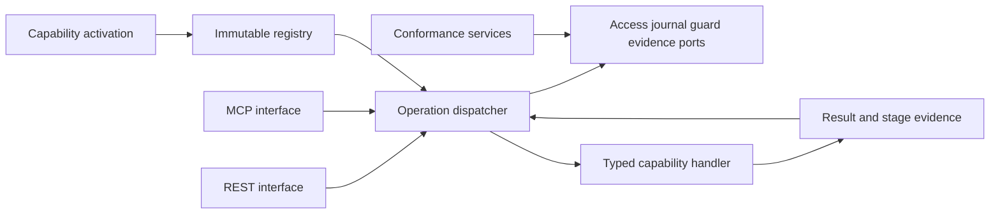
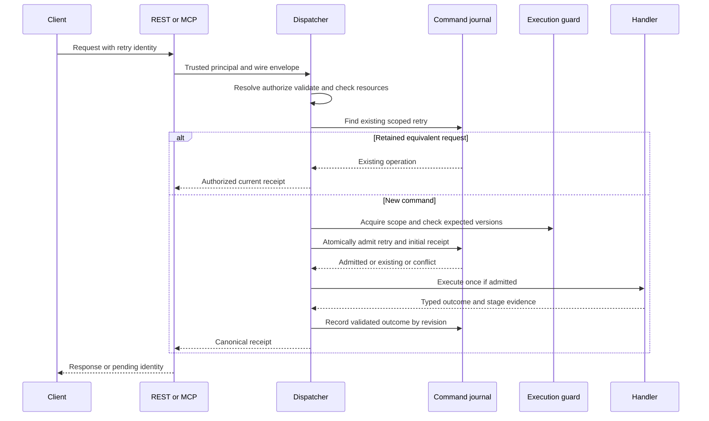

# Design Document

## Overview

CraftReport's operation kernel supplies one versioned invocation contract for independently installed capabilities. Integrators use REST or MCP; capability authors supply typed operations without duplicating access, retry or evidence semantics.

This is a greenfield core. Requirements and this bounded Design were explicitly approved on 2026-10-13. Task-plan approval and implementation remain separate. Its reference executable profile uses synthetic capability fixtures and real HTTP/MCP wiring; it does not deliver the live reporting application.

### Goals

- Enable compatible installed capabilities explicitly and publish one immutable operation registry.
- Preserve input meaning, access scope, retry identity and truthful outcomes across entry points.
- Prove the boundary with independently installable synthetic fixtures and actual clients.

### Non-Goals

Durable storage/recovery, report or data processing, live scheduling, app drivers, browser deployment, XLSX export, AI orchestration, an identity provider, plugin hot reload, an untrusted-code sandbox, a broker or event sourcing.

## Boundary Commitments

### This Spec Owns

- Framework-independent operation, capability, principal, receipt and evidence value contracts.
- Startup activation, typed registration and the fixed invocation pipeline.
- REST/MCP adaptation, capability conformance fixtures, required engineering checks and author documentation.

### Out of Boundary

Snapshot/runtime supplies the durable command journal, authoritative version/execution guards and reconciliation. Report/packs supplies semantics and quality findings. App packages supply target identity, supported-mode checks and effect/readback evidence. Browser verification owns Compose hosting, screenshots/videos and actual save/reopen. No parked source directories or production capability packages are created here.

A fixture-only in-memory journal and synthetic target exist under tests, never as an automatic production fallback. A kernel-only service can expose readiness and discovery; dependent commands remain unavailable until their declared services are supplied. Restart durability is not advertised for the conformance profile.

### Allowed Dependencies

The approved umbrella and kernel requirements are upstream. Standard-library dataclasses, enums and protocols define inward contracts. Application code imports those contracts and its own ports. Pydantic codecs, REST/MCP SDKs and packaging metadata stay in adapters/interfaces/composition. Composition wires concrete instances; it contains no request policy.

Dependency direction: contracts -> application -> adapters/interfaces -> composition, where an arrow means the later layer may import the earlier layer. Adapters and interfaces may not import each other or composition. Capability packages consume published contracts/ports and supply factories; they do not import each other's concrete implementations. Core contracts/application import no ORM, dataframe, app or network framework.

### Revalidation Triggers

Changes to operation/version naming, normalized payloads, retry scope, receipt states, evidence requirements, principal policy, capability compatibility, port guarantees or SDK behavior require revalidation of affected fixtures and all activated consumers. The future browser, runtime, report/packs and GridCraft specs consume these contracts; none is initialized or implemented by this Design.

## Architecture

### Existing Architecture Analysis

The repository contains specs, draft ledgers and a historical JavaScript GridCraft demo. It has no production Python package, dependency lock, Git repository, project hooks or server harness. No prototype code is imported into the kernel. Git initialization and hook installation are explicit implementation prerequisites; no commit, remote or publication is implied.

### Architecture Pattern & Boundary Map

Use a small ports-and-adapters core with typed commands and queries. The registry and dispatcher together form one deliverable invocation boundary; their tests must exercise the actual composition, not just individual handler calls.



Core guards are fixed pipeline stages, not arbitrary plugin middleware. Commands request business work; queries receive inspection-only contexts. The capability factory receives only its declared typed services. Installed code is trusted deployment code: Python import restrictions and conformance checks are architectural controls, not isolation from malicious code.

### Technology Stack

These are the approved exact direct-dependency selections, verified in upstream registry metadata on 2026-10-13. Implementation must resolve them into a checked-in lock and exercise compatibility; discovery has not installed them.

| Layer | Choice / Version | Role | Notes |
| --- | --- | --- | --- |
| Runtime | CPython 3.12, supported range >=3.12,<3.13 | Initial tested runtime | Record exact patch in evidence; widening support requires tests. |
| Contracts | Standard-library dataclasses, enum, typing | Frozen values and typed ports | No framework base class in inward contracts. |
| Validation | Pydantic 2.14.1 | Strict wire models and generated JSON schemas in adapters | One codec path for both transports. |
| HTTP | FastAPI 0.143.0; Uvicorn 0.54.0 | REST and ASGI lifecycle | No FastAPI background tasks as business job storage. |
| MCP | Official mcp 2.3.0, public low-level Server | Registry-driven discovery/calls and Streamable HTTP | No provisional SDK middleware dependency. |
| Packaging | packaging 26.3; Hatchling 1.32.4 | Compatibility ranges; wheel metadata | Standard entry-point discovery. |
| Environment | uv 0.13.0 | Lock and reproducible environments | No dependency installation occurred in Design. |
| Checks | Ruff 0.17.0, Pyright 1.1.414, Radon 6.0.1, pre-commit 4.7.0 | Lint/format, strict typing and budgets | Approved selections; installation/enforcement remain pending. |
| Tests | pytest 9.1.1, httpx 0.28.1 | Contract tests and real server clients | Use standard asyncio runners and SDK client; no extra async test framework required. |

No Polars, database driver, ORM or browser dependency is installed for this kernel. Those remain downstream choices. Production authentication implements the principal-verification interface when deployed; this spec supplies a loopback-only conformance authenticator, not OAuth issuance.

## File Structure Plan

All source/config paths below are planned creations unless listed as modified. Names group responsibilities, not mandatory one-class files. Package __init__.py files contain exports only and inherit their directory's ledger owner.

| Component / responsibility | Concrete files | Ledger owner |
| --- | --- | --- |
| ValueContracts: identity, operation and result values | src/craftreport/contracts/identity.py; operations.py; outcomes.py; capabilities.py within that contracts directory | contracts |
| Registry: immutable descriptors and typed bindings | src/craftreport/application/registry.py | application |
| Dispatcher: fixed guards and invocation | src/craftreport/application/dispatch.py; guards.py; execution.py within application | application |
| ServicePorts: external guarantee contracts | src/craftreport/application/ports.py | application |
| OutcomeRules: evidence requirements and monotone transitions | src/craftreport/application/outcomes.py | application |
| WireCodec: Pydantic boundary conversion and canonical JSON | src/craftreport/adapters/validation.py; canonical.py within adapters | adapters |
| REST interface | src/craftreport/interfaces/http.py | interfaces |
| MCP interface | src/craftreport/interfaces/mcp.py | interfaces |
| Trusted principal adaptation | src/craftreport/interfaces/principal.py | interfaces |
| Activator and assembly | src/craftreport/composition/plugins.py; app.py; settings.py within composition; src/craftreport/__init__.py | composition |
| ConformanceRunner and owned server fixtures | tests/kernel/conftest.py; test_activation.py; test_dispatch.py; test_outcomes.py; test_transport_parity.py; test_disconnect.py; test_conformance.py | development-gates |
| Fixture services | tests/fixtures/kernel_services.py; kernel_server.py | development-gates |
| Independently installable synthetic plugin | tests/fixtures/kernel_plugin/pyproject.toml; tests/fixtures/kernel_plugin/src/craftreport_kernel_fixture/__init__.py; operations.py in that fixture package | development-gates |
| Check entry point and boundary/budget checks | scripts/check.py; scripts/check_breadth.py; scripts/check_quality.py; scripts/check_imports.py; tests/engineering/test_gates.py | development-gates |
| Package/environment/hooks/CI | pyproject.toml; uv.lock; .pre-commit-config.yaml; .github/workflows/kernel.yml; .gitignore | development-gates |
| Author/operator contract | docs/kernel-contract.md; docs/capability-authoring.md; README.md | documentation |

### Modified Files

- breadth.toml: retain two real specs; add .gitignore ownership to development-gates before creation, report actual source counts as they appear, keep future packages parked.
- quality.toml: record reviewed checker/tool versions, limits and extraction policy before enforcement; preserve actual hook/gate state separately.
- .kiro/specs/craftreport-operation-kernel/spec.json and review notes: phase/approval evidence.
- .kiro/steering/tech.md, structure.md, engineering.md, overview.md and roadmap.md: adopt reviewed decisions at approval, then record implemented reality with evidence.

No src/craftreport/runtime, data, reporting, themes, policies, domain, compute or transports directory is created in this slice. No packages/craftreport-gridcraft directory is created. Tests do not become public plugins merely because they have fixture distribution metadata.

## System Flows

### Activation

Read configuration -> enumerate installed entry-point metadata -> select explicit distribution/name pairs -> load selected descriptors -> validate IDs, schemas, settings, compatibility and dependency graph -> initialize factories in dependency order with an AsyncExitStack -> publish immutable registry and readiness. Any failure closes acquired resources in reverse order and leaves readiness false. Cleanup failure is an activation failure. Factories must not mutate business state during activation.

### Invocation



Coarse operation visibility/access is checked before payload validation can reveal private schemas; resource authorization follows typed preparation. Access is checked again before exposing retained receipts. Duplicate lookup precedes current-version checks so an already accepted retry remains inspectable after versions advance. Atomic admission is still required after lookup; lookup alone cannot prevent concurrent execution. A race-losing admission releases its guard and returns the authorized retained receipt.

Guard acquisition is scoped to the authoritative mutation resource; implementations order multiple resource locks consistently. Expected versions are checked while that guard is held, immediately before admission/effect. The guard remains held through the effect or a verified handoff. A metadata comparison alone is not an external mutation fence. Production providers must supply serialization/fencing appropriate to their target before those operations are enabled.

Queries share decoding/access/capability/evidence rules, but use a ReadContext and no command admission or mutation services. An operation inspecting receipts is a query; a recovery operation is a command. Built-in catalog/readiness and receipt inspection return existing metadata directly; they do not recursively create inspection receipts.

## Requirements Traceability

| Requirement | Summary | Components | Interfaces | Flows |
| --- | --- | --- | --- | --- |
| 1.1 | Explicit activation and dependencies | Activator | CapabilityManifest, settings | Activation |
| 1.2 | Reject collisions/incompatibility/cycles | Activator, Registry | ActivationDiagnostic | Activation |
| 1.3 | No partially initialized publication | Activator | Lifecycle scope | Activation rollback |
| 1.4 | Independently enabled operations | Registry | OperationDescriptor | Discovery |
| 1.5 | Versions and verification state | Registry, ConformanceRunner | CapabilityView | Discovery |
| 2.1 | Discover typed contracts/limits | Registry, REST, MCP | Catalog | Discovery |
| 2.2 | Unknown operation/version | Dispatcher | Rejection | Resolve |
| 2.3 | Invalid input/limits | WireCodec, Dispatcher | ValidationIssue | Prepare |
| 2.4 | Invalid result and effect uncertainty | OutcomeRules, WireCodec | OutcomeProposal | Finish |
| 2.5 | Command classification | Registry, Activator | OperationBinding | Activation |
| 3.1 | Common guards | Dispatcher | InvocationEnvelope | Invocation |
| 3.2 | Access and receipt privacy | ServicePorts, Dispatcher | AccessPolicy | Authorize |
| 3.3 | Target capability availability | ServicePorts, Dispatcher | CapabilityCheck | Preflight |
| 3.4 | Missing guarantees block work | Dispatcher, ServicePorts | ServiceUnavailable | Preflight |
| 3.5 | Fixed mandatory guards | Registry, Dispatcher | BoundOperation | Invocation |
| 3.6 | Query inspection only | Registry, Dispatcher | ReadContext | Query |
| 4.1 | Equivalent retained retry | Dispatcher, ServicePorts | RetryKey, OperationJournal | Retry |
| 4.2 | Conflicting content | WireCodec, ServicePorts | Fingerprint, Admission | Retry |
| 4.3 | Concurrent atomic admission | ServicePorts, Dispatcher | OperationJournal.admit | Admission |
| 4.4 | Expected version | ServicePorts, Dispatcher | ExecutionGuard | Guarded effect |
| 4.5 | Ambiguity without replay | OutcomeRules, Dispatcher | Receipt | Retry |
| 5.1 | Identified outcome states | Dispatcher, OutcomeRules | Receipt | Acceptance/finish |
| 5.2 | Rejection correlation | Dispatcher, REST, MCP | Rejection | Reject |
| 5.3 | Stages/versions/evidence | OutcomeRules, ServicePorts | StageResult, EvidenceRef | Inspect |
| 5.4 | Completion needs evidence | OutcomeRules | EvidencePolicy | Finish |
| 5.5 | Missing retained content | ServicePorts, Dispatcher | Unavailable | Inspect |
| 5.6 | Safe diagnostics | OutcomeRules, REST, MCP | Diagnostic | Error |
| 6.1 | Software/MCP invocation | REST, MCP, Dispatcher | HTTP routes, MCP tools | Real clients |
| 6.2 | Canonical transport parity | WireCodec, REST, MCP | InvocationResult | Parity |
| 6.3 | AI/notebook independence | Activator, ConformanceRunner | Public fixture composition | Boot/invoke |
| 6.4 | Same checks for AI callers | Dispatcher | Trusted Principal | Invocation |
| 6.5 | Disconnect and receipt inspection | Dispatcher, ServicePorts | Execution ownership, retry | Disconnect |
| 7.1 | Identified conformance evidence | ConformanceRunner | ConformanceManifest | Verify |
| 7.2 | Required negative/concurrent cases | ConformanceRunner | Test suite | Verify |
| 7.3 | Pending/failed support claims | Registry | VerificationRecord | Discover |
| 7.4 | Synthetic evidence scope | ConformanceRunner | EvidenceScope | Verify |

## Components and Interfaces

| Component | Layer | Intent | Key dependencies | Selected contracts |
| --- | --- | --- | --- | --- |
| ValueContracts | Contracts | Immutable shared values | Standard library | Service, State |
| Activator | Composition | Assemble one compatible registry | Registry P0; packaging metadata P0 | Service, State |
| Registry | Application | Typed lookup/catalog | ValueContracts P0; registered codecs P0 | Service |
| WireCodec | Adapter | Strict payload/result conversion | Pydantic P0 | Service |
| Dispatcher | Application | Fixed invocation pipeline | Registry, ServicePorts, OutcomeRules P0 | Service, State |
| ServicePorts | Application | Explicit external guarantees | Configured providers P0 | Service, State |
| OutcomeRules | Application | Truthful outcomes/evidence | ValueContracts P0 | Service |
| REST and MCP | Interfaces | Adapt protocols, preserve meaning | Dispatcher P0; official SDKs P0 | API |
| ConformanceRunner | Tests | Real composition/client evidence | Fixture plugin and services P0 | Batch |

### ValueContracts, Registry and WireCodec

**Requirements:** 2.1, 2.2, 2.3, 2.4, 2.5, 6.2. **Inbound:** Activator and Dispatcher (P0). **Outbound:** codec protocol (P0). **External:** Pydantic only inside adapter implementations (P0).

Service signatures describe the public typed boundary; implementation may split files without changing it:

```python
class Codec[T](Protocol):
    def decode(self, value: JsonObject) -> T: ...
    def encode(self, value: T) -> JsonObject: ...
    def schema(self) -> JsonObject: ...

class QueryHandler[Q, R](Protocol):
    async def __call__(self, request: Q, context: ReadContext) -> R: ...

class CommandHandler[Q, R](Protocol):
    async def __call__(
        self, request: Q, context: CommandContext
    ) -> OutcomeProposal[R]: ...

class OperationRegistry(Protocol):
    def resolve(self, name: str, version: str) -> BoundOperation | None: ...
    def describe(self) -> tuple[OperationDescriptor, ...]: ...
```

Each generic OperationBinding pairs its input/result codecs and handler at registration; a typed adapter retains those type parameters while exposing a non-generic BoundOperation to dispatch. Do not use an Any-typed handler dictionary or unchecked casts to bridge heterogeneity. BoundOperation.prepare returns a PreparedCall containing validated canonical content, resource references and a typed invocation closure. Resource extraction is pure and executes before business behavior; author-controlled extraction is checked by conformance fixtures.

Wire models use Pydantic strict validation, forbidden extra fields and explicit serializers, then map to ordinary immutable values. Both transports hand the same JsonObject to the same codec; neither transport validates business input independently or converts dates/numbers first. Do not mix strict validate_json and strict validate_python policies for equivalent requests.

The v1 wire profile accepts null, booleans, UTF-8 strings, lists, string-key objects and finite interoperable JSON numbers. Integers outside +/- (2^53 - 1) require an operation-declared string/tagged representation. Decimal quantities and producer versions use declared strings, not implicit binary64 conversion. Reject duplicate JSON keys at raw REST decoding and non-finite values on both paths. Preserve array order and string contents. Defaults come only from the versioned contract; aliases or numeric coercion are not implicit.

Fingerprint the canonical normalized envelope, including operation/contract version, resolved defaults, resource references and expected versions. Use deterministic sorted-key compact UTF-8 serialization and SHA-256 under a versioned canonicalization policy; exclude correlation IDs and transport headers. The policy defines equality for this Python service, not a claim of cross-language RFC canonicalization. Pin normalization for the lifetime of retained retries.

### Activator

**Requirements:** 1.1, 1.2, 1.3, 1.4, 1.5, 2.5. **Inbound:** app lifespan (P0). **Outbound:** Registry and declared services (P0). **External:** importlib.metadata and packaging (P0). **Contracts:** Service and State.

Configuration selects exact installed distribution/entry-point identities. The entry-point group is craftreport.capabilities; its callable returns a CapabilityFactory with describe() -> CapabilityManifest and open(services, settings) -> AsyncContextManager[CapabilityInstance]. Manifest discovery itself must be side-effect free apart from trusted import initialization.

Operation names match [a-z][a-z0-9_.]{0,47}; contract versions are positive integer strings. Generated MCP names append .v plus that version and must fit the SDK/protocol name limit; reject invalid names at activation. Two owners cannot register the same operation/version key.

Manifest fields: ID, package/version, core-contract range, provided capability versions, required capability ranges, settings schema, operation descriptors and implementation digest. Use packaging Version/SpecifierSet for declared compatibility; initial core contract is 1.0.0. Require explicit dependency selection; never auto-install or auto-enable packages. Reject duplicate provided IDs, duplicate operation/version keys, generated MCP-name collisions and use of the reserved craftreport namespace.

CapabilityInstance supplies matching typed bindings and a lifecycle closer. A manifest/binding mismatch aborts startup. Factories get a purpose-specific service bundle with only declared ports, not a global container, SQL session or unrestricted app client. Query registration accepts only query contexts and no mutation service bundle. This does not sandbox trusted Python code.

VerificationRecord is operator-loaded evidence keyed by package version/digest, core contract, fixture-suite identity and dependency versions. Missing/stale evidence yields pending, a recorded failed run yields failed, and matching passing conformance yields passed with scope. A plugin's self-declared supported flag cannot create a passed record.

### Dispatcher and ServicePorts

**Requirements:** 3.1, 3.2, 3.3, 3.4, 3.5, 3.6, 4.1, 4.2, 4.3, 4.4, 4.5, 6.5. **Inbound:** interfaces (P0). **Outbound:** Registry, OutcomeRules and supplied providers (P0). **Contracts:** Service and State.

```python
class Facade(Protocol):
    async def invoke(
        self, principal: Principal, request: InvocationEnvelope
    ) -> InvocationResult: ...
    async def catalog(self, principal: Principal) -> Catalog: ...
    async def inspect(
        self, principal: Principal, operation_id: str
    ) -> Receipt | Rejection: ...

class AccessPolicy(Protocol):
    async def authorize(
        self, principal: Principal, action: AccessAction
    ) -> AccessDecision: ...

class OperationJournal(Protocol):
    async def find(self, key: RetryKey) -> RetainedCommand | Missing: ...
    async def admit(self, intent: CommandIntent) -> Admission: ...
    async def record(
        self, operation_id: str, expected_revision: int, update: ReceiptUpdate
    ) -> Receipt | RevisionConflict: ...
    async def read(self, operation_id: str) -> Receipt | Missing: ...
    async def record_query(self, observation: QueryObservation) -> Receipt: ...

class ExecutionGuard(Protocol):
    def acquire(self, preconditions: Preconditions) -> AsyncContextManager[GuardLease]: ...

class CapabilityResolver(Protocol):
    async def check(
        self, requirements: tuple[CapabilityRequirement, ...], resources: tuple[ResourceRef, ...]
    ) -> CapabilityDecision: ...

class EvidenceReader(Protocol):
    async def inspect(self, refs: tuple[EvidenceRef, ...]) -> tuple[EvidenceStatus, ...]: ...
```

Admission is a discriminated union: admitted with new operation ID, existing with retained ID/fingerprint, conflict, or unavailable. It atomically inserts retry identity and initial accepted receipt. A provider must never report admitted before that record exists. Retry key is deployment scope + authenticated principal subject + operation name + contract version + caller key; tenant scope is server-derived. No key is shared merely because callers submitted the same text.

There is no automatic eviction during conformance runs. Discovery reports the configured retry retention guarantee. Unknown retention after a provider failure means unavailable, not definitely absent. If an admission response is lost, lookup/reconciliation is required before effect; no blind second dispatch.

Preflight obtains authorization, required service health, target capability decisions and evidence availability. GuardLease validates expected versions and asserts it is current before dispatch. Providers must stop work when the guard is lost; where an external call cannot be stopped, the outcome is ambiguous and later reconciliation is required. The kernel cannot manufacture a distributed fencing guarantee.

CommandContext contains operation identity, authenticated scope, guard lease and the capability's declared services; it does not expose registry mutation or canonical journal completion. ReadContext contains identity and explicitly read-only services. Service exceptions are typed unavailable/conflict outcomes; raw exceptions are sanitized at the dispatcher boundary.

Task 5.1 implementation clarification: `application/dispatch_ports.py` owns the narrow `ServiceHealth.check(required)` and `InvocationLimits.check(request, limits)` / `check_result(value, limits)` boundaries. Health probes are operator-allowlisted observations of the configured guarantee providers; a missing probe is unavailable, never an optimistic fallback. The shared adapter checks the normalized decoded envelope (including metadata defaults) only after coarse access. `WireFailure` is application-owned and re-exported by the codec adapter; the dispatcher exposes only approved limit names and schema field locations. Separately retained result content uses `ResultStore.write(principal, operation_id, value) -> str` and `read(principal, operation_id, reference) -> RetainedResult`; references are scoped to the trusted deployment/principal/operation and reads distinguish available, missing, inaccessible and unavailable. Only dispatcher code receives the writer. Query completion requires exact immutable content readback before `record_query`; neither a write acknowledgement nor an invented reference establishes availability. This adds no production storage, durability guarantee or public retrieval endpoint and leaves the Facade/Receipt signatures unchanged. These contract refinements require revalidation of codec/provider consumers. The guarded query and inspection collaborators compose with command admission/execution in tasks 5.2–5.3; they are not a prematurely completed full Facade.

Task 5.2 implementation clarification: `application/admission.py` owns command admission and accepts an injected versioned fingerprint protocol, implemented by `adapters/canonical.py`. Commands require a caller retry key. For a new command declaring `changes_business_state`, expected versions must cover every prepared resource; a command that only starts work may omit them. Resource extractors must identify every actual mutation target. Authorized retained lookup precedes these new-admission checks and guard acquisition; acquisition conflicts recheck retained identity to handle races with a completed effect. `CommandAdmission.open()` yields either a retained receipt/rejection or one-shot `AdmittedCommand` authority and holds the authoritative lease through context exit. Only acknowledged atomic winners with matching retained readback can invoke; lost acknowledgements reconcile without taking execution authority. The later application execution owner consumes this context inside its retained task. This collaborator does not itself provide lifespan ownership, capacity, deadlines, shutdown, receipt finalization or remote exactly-once effects.

The dispatcher owns strong references to admitted in-process execution tasks under its app lifespan. Client timeout/disconnect stops waiting, not that execution. A shielded wait returns a pending receipt at the configured response deadline. This is bounded in-process execution, not a durable scheduler. A handler returning pending must supply a recorded handoff reference to an installed execution owner; without it, pending is invalid.

Task 5.3 implementation clarification: `application/dispatch_ports.py` defines `RecordedHandoff` with trusted principal, operation identity, reference, owner identity and resource-version pins. `HandoffReader.inspect` verifies an installed owner's retained acceptance; `HandoffStore.record` lets the dispatcher record its own local lifespan ownership and requires independent readback before a pending receipt. External owners must acknowledge ownership and assume the required resource fencing before the local lease is released. A handler-supplied string alone proves neither. `ReceiptUpdate.handoff_ref` already carries the journal-side reference; its retained metadata remains inspectable through the provider contract without adding a public receipt field. A pending-to-pending update is permitted only for a newly verified owner transfer, with monotone revision and append-only history. Terminal receipts remain immutable. Temporary conformance providers establish these scoped behaviors without a durability or distributed-fencing claim.

Shutdown stops admission, allows bounded completion, and records interrupted in-flight effects as ambiguous where the journal remains available. Provider failure after effect leaves the last retained non-complete state and a safe unavailability diagnostic; it cannot become success. Production restart reconciliation remains a downstream guarantee. Failures known to precede effect may be failed; cancellation alone cannot establish that fact.

### OutcomeRules

**Requirements:** 2.4, 4.5, 5.1, 5.2, 5.3, 5.4, 5.5, 5.6. **Inbound:** Dispatcher (P0). **Outbound:** EvidenceReader and journal updates through Dispatcher (P0). **Contracts:** Service.

OutcomeProposal contains typed result if available, effect disposition (none, applied, partial, unknown), stage outcomes and evidence references. The core validates output schema and required evidence before producing a ReceiptUpdate. No handler can write canonical completion directly.

Allowed progress: accepted -> pending -> complete/partial/ambiguous/failed, also direct accepted -> terminal where observed. Completion requires valid result and all declared completion evidence passed for the exact operation/resource versions. Ambiguous -> terminal requires new reconciliation evidence; retries never invoke that transition. Terminal receipts are immutable; later recovery attempts link previous operation identities. Evidence amendments are append-only with monotone revision.

Rejected requests have a Rejection with correlation ID, code and stage; they have no accepted operation ID. Result-schema failure after known partial effect remains partial; after unknown effect it is ambiguous; even a known fully applied effect cannot be labeled complete when its required result/evidence contract fails.

Diagnostics use allowlisted fields and sanitized locations; do not echo input values, credentials, private schema bodies or arbitrary exception messages. EvidenceReader reports available, missing, inaccessible or unavailable separately; no missing content is treated as reproducible. Query receipts are recorded through OperationJournal.record_query when invoked as business operations; catalog/readiness discovery does not create business work.

### REST and MCP

**Requirements:** 2.1, 3.2, 5.2, 5.6, 6.1, 6.2, 6.3, 6.4, 6.5. **Inbound:** ordinary clients (P0). **Outbound:** Facade and principal resolver (P0). **External:** FastAPI/MCP SDK (P0). **Contracts:** API.

| REST route | Request | Canonical response |
| --- | --- | --- |
| GET /health/ready | none | activation readiness and deployment epoch; no private catalog |
| GET /v1/catalog | authenticated request | permitted capabilities/operations/schemas/limits |
| POST /v1/invoke | InvocationEnvelope | Receipt or Rejection |
| GET /v1/operations/{operation_id} | authenticated request | authorized receipt or unavailable/not-found rejection |

POST accepts commands and queries but advertised kind controls execution. No REST endpoint bypasses Facade. API documentation is generic; private operation schemas come only from authorized catalog discovery. Catalog responses are private/no-store.

Use public mcp.server.Server(on_list_tools=..., on_call_tool=...). Return deterministic authorized tools from the same registry on each request. Tool names map explicitly to operation/version keys (for example fixture.set.v1); no interpretation of arbitrary method paths. Publish the invocation envelope schema with operation identity bound by the tool descriptor and the complete object-root Receipt|Rejection output schema. tools/call obtains a trusted principal and routes to Facade. Built-in catalog/receipt inspection share the same policy as REST. Tool hiding never replaces invocation authorization.

SDK Python fields use Tool(input_schema=..., output_schema=...) and CallToolResult(structured_content=..., content=..., is_error=...). structured_content carries the canonical REST-equivalent object; TextContent carries the same serialized JSON for client compatibility. is_error is true for rejection and failed/partial/ambiguous business outcomes, false for accepted/pending/complete. Transport/protocol failures are separate; never turn a protocol parse error into an accepted business receipt.

Construct streamable_http_app before startup, mount at root after REST routes with internal /mcp, and enter server.session_manager.run() from the top-level FastAPI lifespan. Use json_response=True and stateless_http=True: protocol session lifetime does not own operations. Restrict Host/Origin explicitly. Do not expose protected operations through unauthenticated SDK custom routes.

Principal comes from the authenticated HTTP boundary, never request payload or an unverified forwarding header. Both interfaces translate the same verified subject/scope into Principal. The loopback conformance server uses generated test tokens and binds only 127.0.0.1; a remote bind with that profile fails startup. Production mode requires a supplied authenticator and access policy; default is deny. Actual OAuth interoperability/issuer setup belongs to deployment scope.

## Data Models

### Domain and Logical Model

No physical database schema is owned here.

| Value | Essential fields and invariants |
| --- | --- |
| Principal | deployment scope, subject, permitted scopes; immutable, server-derived |
| InvocationEnvelope | operation, contract_version, payload, correlation_id, retry_key for commands, expected_versions; unknown fields rejected |
| OperationDescriptor | command/query kind, schemas, resources, required capabilities/services, limits, completion evidence requirements |
| CommandIntent | retry key, fingerprint, normalized-policy version, operation/capability versions, resource/precondition refs |
| Receipt | operation_id, revision, state, input/result references, stage results, sanitized diagnostics, evidence refs, deployment epoch, retention profile |
| StageResult | named stage, passed/failed/pending/not-applicable, reason code and evidence refs; no implicit success |
| EvidenceRef | opaque identity, scope, operation/resource/version pins, content digest when applicable; not an arbitrary filesystem path |
| ConformanceManifest | code/wheel hashes, dependency lock hash, capability/contract versions, requirement IDs, cases/results, environment/profile, cleanup result |

An accepted retry record and receipt have one canonical owner, OperationJournal. Interfaces keep no independent operation state. Registry state is an immutable activation snapshot. Result/evidence availability is separate from metadata retention.

### Data Contracts & Integration

JSON schemas are versioned with operations; field removal, changed normalization or changed meaning requires a new contract version and consumer revalidation. Discovering a newer contract never silently upgrades a request. Capability versions and operation contract versions are distinct.

Approved default conformance limits for implementation: 1 MiB decoded invocation envelope, nesting depth 32, 16 concurrent admitted operations, 5-second response-wait deadline and 10-second shutdown grace. Limits are configuration values exposed in discovery, exercised at/beyond boundaries, and do not claim financial/report throughput. Providers may declare lower operation limits. Refuse admission at capacity without reserving a retry key; retries/inspection remain available. Serialization/output size is checked before a complete response; oversized results become result-contract failure with truthful effect status.

## Error Handling

| Condition | Canonical code | REST mapping | Effect rule |
| --- | --- | --- | --- |
| Unknown/inaccessible operation or receipt | not_found | 404 | Do not expose hidden existence |
| Missing/invalid credentials | unauthenticated | 401 | No invocation |
| Denied visible operation/resource | forbidden | 403 | No restricted result |
| Invalid input | invalid_input | 422 | No handler invocation |
| Oversize | limit_exceeded | 413 | Reject before admission |
| Retry/version conflict | conflict | 409 | No new effect |
| Required service unavailable | unavailable | 503 | No dependent effect |
| Capacity exhausted | capacity_exceeded | 429 | No accepted work |
| Accepted/pending business work | receipt state | 202 | Inspect retained operation |
| Recorded terminal business outcome | receipt state | 200 | Body distinguishes complete/failed/partial/ambiguous |
| Result/evidence violation | stage diagnostic in receipt | 200 if receipt recorded, otherwise 503 | Never synthesize complete |

MCP preserves the same canonical codes and states inside tool results; HTTP codes are transport adaptation only. Logs contain correlation/operation IDs, capability/version, stage, duration and safe code, not raw payloads. Provider/activation diagnostics are available only to the configured operator scope.

## Testing Strategy

### Requirement-Derived Contract Cases

- Activator: two real installed fixture distributions/versions where needed; selected versus unselected imports, missing dependency, cycles, duplicate IDs/tool names, incompatible version, settings failure and reverse cleanup (1.1–1.5, 2.5).
- Codec: missing/extra fields, bool versus int, numeric-string rejection, unsafe integer/decimal representation, defaults, object-key order, arrays and equivalent wire requests; malformed results after each effect disposition (2.1–2.4, 6.2).
- Guard/journal: barriers force 20 equivalent concurrent requests and conflicting content; exactly one synthetic effect, same accepted ID; stale expected version, cross-subject retry isolation, service unavailable before effect and admission acknowledgement loss (3.1–3.5, 4.1–4.5).
- OutcomeRules: missing/mismatched evidence, partial/unknown effect, inaccessible evidence, monotone receipt revisions and rejected-request correlation (5.1–5.6).
- Query context: inspection never changes canonical fixture state; a deliberately misclassified fixture is rejected by conformance (2.5, 3.6).

### Actual Transport and Runtime Integration

Build/install the kernel wheel and a separate fixture wheel in an isolated environment. Launch an owned loopback server subprocess from tests/fixtures/kernel_server.py. Use httpx over actual sockets and the official MCP Client in auto protocol mode. Record negotiated protocol version; do not make a legacy initialize exchange the sole connectivity assertion.

Run discovery -> valid command -> inspect query -> equivalent retry through the other transport -> read the fixture target state through its query. Compare canonical payloads excluding intentionally distinct request correlation/timing fields. Repeat with two test principals, missing/invalid credentials, hidden schemas, denial, wrong versions and disabled AI. The real registry, codecs, dispatcher, lifespan and adapters remain wired (6.1–6.4, 7.1–7.2).

Disconnect a client after a barrier proves admission and before the synthetic target change completes; inspect/retry through a new client. Assert one effect and the same identity, not an inferred failure. Repeat journal outage after effect and inspect its non-complete/ambiguous state without replay (4.5, 6.5). A disposable disconnected-handler variant must fail the effect assertion; correct wiring is restored before final evidence.

The fixture target and in-memory ports are explicitly synthetic. A restart produces a new deployment epoch and missing old temporary state, never a durability claim. This verifies the agreed kernel boundary, not the umbrella's restart requirement (7.4).

### Conformance Evidence and Cleanup

ConformanceRunner writes artifacts/<run-id>/kernel-manifest.json, client transcripts with secrets removed, cases.json, JUnit output, server diagnostics and cleanup.json. It records 36-criterion coverage, wheel/lock hashes and fixture identities. Status is passed only when assertions, expected diagnostic checks and owned-process cleanup pass. Stale/wrong-build results are pending, not reusable success (1.5, 7.1–7.4).

No browser evidence is required to close a kernel-only contract case. Parent acceptance still requires actual GridCraft screenshots, videos, app effects and persisted XLSX/reopen. Those later runs reference the same operation/evidence identities and remain unverified.

### Engineering Gates and Planned Commands

Use Pyright strict across src, scripts and tests, plus Ruff lint/format. New capability imports and most-specific ledger ownership are checked over the whole tree. Tests are measured separately from production budgets.

Approved kernel limits: function 50 LLOC, module 300 LLOC, capability 1,500 LLOC, McCabe 10. Modules count the complete source once. For each FunctionDef/AsyncFunctionDef, measure the dedented source segment from first decorator through end_lineno with Radon raw analyze(...).lloc; nested definitions remain included in the outer segment and are also checked individually, but module/capability totals count files once. Treat unsupported syntax/extraction failure as check failure, not zero. Test decorated/async/nested/multiline fragments against pinned Radon; declaration lines and decorators are included, comments/blanks follow Radon's definition. Waivers require exact scope, approval and expiry per quality.toml.

Implementation provides these commands, none currently runnable here:

- uv sync --frozen --group dev
- uv run python scripts/check.py --fast (Ruff check/format --check, Pyright, breadth/import/size gates, focused unit checks)
- uv run python scripts/check.py --integration (actual REST/MCP wheel-installed conformance)
- uv run pre-commit install and uv run pre-commit run --all-files

Pre-commit and CI call the same pinned --fast command with whole-scope checks, not staged-file-only aggregates. CI also runs --integration and scheduled retirement-age checks. Initialize Git before hook installation; no task may claim hooks installed without a real invocation result. Budget/tool selections and the relevant ledger ownership require review before associated implementation lands.

## Interaction and Verification Contract

- **Reference:** the user's real-effect/owned-resource workflow from because-security-quant-terminal informs diagnostics and cleanup. The kernel has no visual surface; socket clients plus the synthetic target's independently inspected state are its actual boundary oracle.
- **State owners:** Registry owns activated definitions; OperationJournal owns accepted identities/receipts; the fixture target owns its synthetic business state; evidence files own recorded test observations. Draft Design is not runtime state.
- **Identity:** deployment epoch, principal scope, operation/capability/contract version, retry key, fixture target/version and evidence digest are recorded. No GridCraft session or document is invented.
- **Interaction:** discovery and invoke/inspect map to the fixed guards above; only command admission permits effect, and only required readback evidence permits completion.
- **Isolation:** kernel tests own their subprocess, port, tokens and artifact folder. They do not attach to the user's open app or tear down external services. Browser/Compose ownership belongs to the next spec.
- **Ownership/budgets:** planned code uses contracts, application, adapters, interfaces, composition, development-gates and documentation ledger entries; source counts remain zero until implementation. Numeric limits above are approved for the listed kernel capabilities; enforcement remains pending.
- **Highest risk:** effect occurs but acknowledgement/evidence persistence is lost; retained retries must remain non-complete/ambiguous and never dispatch again automatically.
- **Checks available now:** document/metadata/traceability validation only. Project hooks, Python checks, server conformance, browser and artifact checks are not implemented.

## Rollout and Remaining Risks

Design approval is recorded; the generated task plan requires its own review. First implementation establishes Git/package/locked checks and fixture packaging; then activation/contracts, guarded dispatch, interfaces and actual client conformance. These steps build one invocation boundary and do not activate downstream report modules.

Adding production providers later requires their own conformance evidence for atomic journal admission, authoritative guard semantics, retention and restart. The kernel cannot promise exactly-once remote effects merely from a retry key. Private templates remain declarative and separate from installed executable capabilities.

If dependency resolution or the wheel-installed smoke exposes an SDK incompatibility, record the failure and revise/pin the smallest affected adapter; do not silently replace the agreed public contract. Wider deployment authentication and persistence stay explicit downstream prerequisites.

## Supporting References

- [Research and decision log](research.md) records current official SDK, packaging, validation and tooling sources.
- [Approved kernel requirements](requirements.md), [umbrella acceptance baseline](../craftreport-reporting-facade/requirements.md), [roadmap](../../steering/roadmap.md).
