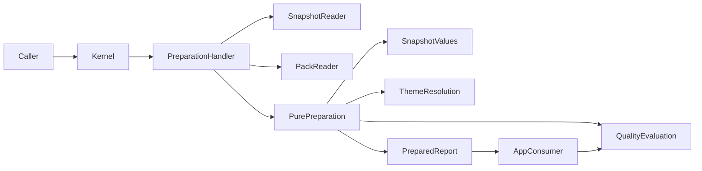

# Design Document

## Overview

A report owner reuses one table/line-chart definition against two supplied snapshots and receives exact typed content, resolved semantic presentation and a scoped quality decision through the existing facade. This is a small report preparer: a closed schema and pure functions, with configured pack loading at the edge.

Goals are reproducible supplied-value preparation, reusable semantic themes, safe public/private packs and truthful draft/release findings. Non-goals are calculations, arbitrary expressions, a designer, storage/scheduling, target mutation, XLSX production and new generic plugin/policy infrastructure. This Design uses the bounded overnight `-y` authorization; phase acceptance still requires the recorded independent review.

## Boundary Commitments

### This Spec Owns

- Reporting definition, resolved parameter and prepared-report values; deterministic binding projection into one table and one line chart initially.
- Semantic themes, declarative pack compatibility/source resolution and separate source/artifact visibility metadata.
- Closed reporting check identifiers, scoped findings, evidence invalidation and draft/release decisions.
- Three operation registrations, public preparation recipe and verified feature quickstart.

### Out of Boundary

Snapshot-runtime solely owns `data.values.Snapshot`, input requirements/completeness, accepted input retention, run/binding lifecycle, scheduler and persistent journal. The compiler never imports runtime or copies the snapshot schema. Kernel owns guard order, operation identity, receipts, codecs, retries and result readback. GridCraft owns style-support claims, mutation, real output comparison, visible draft designation, export/reopen and observed evidence. No financial/GIPS evaluation is activated.

### Allowed Dependencies

Pure dependency direction is `contracts -> data values/requirements -> themes/policies values -> reporting values/preparation`. Themes and policies depend only on contracts and standard library, never reporting; policy input is a digest-and-check scope, avoiding a cycle. Boundary adapters may use installed Pydantic and packaging. Feature-owned reporting.operations/reporting.ports depend on pure reporting values and exact public kernel application interfaces; pure reporting modules cannot import those orchestration modules. Neither feature handler nor pure modules import concrete pack readers, runtime or interface SDKs. Only data.ports imports the exact kernel Missing/VersionConflict/ServiceUnavailable values from application.service_values. Composition injects configured loader and snapshot reader. REST/MCP remain existing kernel transports.

### Revalidation Triggers

Changes to scalar precision/nullability, snapshot reference, definition/prepared schema, content fingerprint, semantic roles, check applicability, access scopes or target capability identifiers require snapshot-runtime/GridCraft consumer revalidation. Pack version bytes cannot change in place. Changed target revision invalidates output checks even if prepared content is unchanged. Gate/import changes require negative fixtures proving forbidden imports still fail.

## Architecture

### Existing Architecture Analysis

The installed kernel uses frozen dataclasses for retained values, strict Pydantic boundary codecs, immutable operation registries and capability activation. `require_immutable` rejects retained BaseModel/live handles. Reuse these contracts and the generic REST/MCP dispatch/readback endpoints. No new web framework, queue, schema parser or operation journal is introduced.

### Architecture Pattern and Boundary Map



The app supplies observations after real effects. Successful preparation emits no target-mutated/artifact-persisted/reopened evidence.

### Technology Stack

| Layer | Choice / version | Role |
| --- | --- | --- |
| Runtime/contracts | CPython >=3.12,<3.13, standard dataclasses/Decimal | Frozen inward values, exact supplied values |
| Validation | Existing Pydantic 2.14.1, existing PydanticCodec | Strict closed wire vocabulary and schema generation |
| Compatibility | Existing packaging 26.3 | Version and SpecifierSet checks; no custom version grammar |
| Packs | Standard JSON and pathlib | Configured immutable manifest/content reads; no archive/plugin execution |
| Interfaces | Existing FastAPI 0.143.0 and MCP 2.3.0 | Existing dispatch, catalog and result readback only |
| Quality | Existing pinned Ruff/Pyright/pytest/Radon/hooks | Unchanged 50/300/1,500/10 limits for every newly activated owner |

No dependency changes are needed. Public content installation/discovery is explicitly wired from a configured root in the first slice; no recursive ambient filesystem search or external pack download.

## File Structure Plan

All source paths are proposed until task 1 activates exact ownership. Files stay below 300 LLOC through responsibility-based extraction, not arbitrary shards.

| Files | Responsibility / owner |
| --- | --- |
| `src/craftreport/reporting/definitions.py` | Frozen definition/parameter/projection values; reporting |
| `src/craftreport/reporting/prepared.py` | Immutable target-neutral content/result values; reporting |
| `src/craftreport/reporting/prepare.py` | Pure parameter/binding projection and content identity; reporting |
| `src/craftreport/themes/values.py` | Semantic theme and pack manifest/pin values; themes |
| `src/craftreport/themes/resolve.py` | Pure override/compatibility and theme resolution; themes |
| `src/craftreport/policies/values.py` | Check scope, finding, observation and release values; policies |
| `src/craftreport/policies/evaluate.py` | Pure applicability/invalidation and eligibility; policies |
| `src/craftreport/adapters/report_models.py`, `report_codecs.py` | Strict Pydantic wire fields and explicit domain/JSON conversion; adapters |
| `src/craftreport/adapters/pack_reader.py` | Bounded configured-root JSON loading and immutable manifest read; adapters |
| `src/craftreport/reporting/ports.py`, `operations.py` | Feature-owned PackReader/PreparationFactWriter protocols and guarded validation/discovery/preparation handlers/registrations; reporting |
| `src/craftreport/adapters/report_resources.py` | Immutable pack resource observations, delegating guard and typed preparation-fact conversion; adapters |
| `src/craftreport/composition/reporting.py` | Capability descriptor/provider and dependency injection; composition |
| `tests/reporting/test_definitions.py`, `test_prepare.py`, `test_themes.py`, `test_policies.py`, `test_packs.py`, `test_operations.py` | Requirement-derived unit/contract coverage |
| `tests/reporting/test_preparation_clients.py` | Installed REST/MCP public preparation and retained-result parity |
| `examples/reports/supplied_portfolio.json`, `examples/templates/public_report/manifest.json`, `examples/themes/house.json` | Synthetic public definition, pack and semantic profile; public-packs |
| `scripts/examples/prepare_reusable_report.py` | Ordinary caller recipe; existing development-gates executable owner, explicit scope activation |
| `docs/quickstarts/Quickstart_How_to_prepare_a_reusable_report.md` | Verified adopter guide; update `docs/quickstarts/index.md` and relevant entry point |
| `quality.toml`, `breadth.toml`, `scripts/check_imports.py`, `tests/engineering/test_boundary_gates.py` | Root-coordinated exact activation and boundary fixtures; existing development-gates owner |

Extend the existing engineering boundary fixtures. Snapshot-runtime supplies `contracts.pins`, `data.values`, `data.requirements`, exact scalar wire conversion and `data.ports`; this spec consumes those files and never edits them. Shared gate/composition changes serialize through root. Existing application source remains unchanged at measured 1,449/1,500 LLOC.

Planning allocations, not new limits: reporting approximately 900 LLOC including feature ports/operations, themes 300 and policies 250; additions to existing adapters approximately 400, composition 100 and development-gates recipe/check integration 170. Measured starting totals are adapters 489, composition 360, development-gates 1,042; reserve sibling snapshot additions approximately 150/200/150 respectively, forecasting shared totals 1,039/660/1,362. Root reconciles actual totals before acceptance; if a forecast does not fit, simplify code at its responsibility seam or stop for review, without raising caps or moving files to evade them. All default caps remain 1,500 and local 50/300/10.

## Components and Interfaces

| Component | Intent | Requirements | Dependencies / selected contracts |
| --- | --- | --- | --- |
| DefinitionPreparation | Resolve bounded declarations into exact supplied content | 1.1–1.6, 2.1–2.6 | Inbound handler P0; outbound data values/completeness P0; Service |
| ThemeResolution | Resolve semantic roles and compatibility | 3.1–3.5 | Inbound preparer P0; external packaging P1 at boundary; Service |
| ConfiguredPackReader | Read authorized exact pack versions | 4.1–4.8 | Inbound handler P0; configured roots/access P0; Service |
| QualityEvaluation | Evaluate scoped checks and draft/release | 5.1–5.9 | Inbound preparer/app observations P0; kernel EvidenceRef P0; Service |
| PreparationOperations | Shared software access and retained result | 6.1–6.6 | Inbound kernel P0; snapshot/pack ports P0; API/Service |

### DefinitionPreparation

**Contracts: Service.** Frozen stdlib dataclasses are authoritative inward values. Pydantic wire models follow the existing boundary pattern, forbid extra fields, use discriminated unions and return these values through the existing codec. JSON/schema conversion stays at the adapter boundary. No second mutable report state or schema parser is added.

```python
def requirements_for(definition: ReportDefinition,
                     parameters: tuple[tuple[str, Scalar], ...]) -> InputRequirements: ...
def prepare(definition: ReportDefinition, parameters: tuple[ParameterValue, ...],
            snapshot: Snapshot, pack: ResolvedPack,
            theme: ResolvedTheme,
            identify: Callable[[PreparedReport], str]) -> PreparedReport | PreparationFailure: ...
```

Preconditions: definition/pack bytes validated; parameter names unique; exact SnapshotRef read and authorized. Postcondition: either complete immutable content or typed failure, never partially prepared complete output. Errors use closed codes and safe tuple locations; the handler converts them into kernel diagnostics.

#### Closed definition vocabulary

The independently reviewed [declaration boundary clarification](declaration-boundary-clarification.md) assigns frozen declaration invariants and typed parameter/requirements validation to task 2.2. Task 7 owns strict Pydantic raw JSON validation, including unknown/executable fields, before task 8 exposes operations. This preserves the pure reporting import boundary and all acceptance constraints without a duplicate parser.

- `ReportDefinition(schema_version='1', report_id, version, title, parameters, table, chart, release_policy, compliance_statement=None)`. One table and one line chart are mandatory for the first workflow; optional future content kinds are rejected.
- `ParameterDefinition(name, kind, required, default, choices, minimum, maximum)`; scalar kinds text/bool/int64/decimal/date/datetime as upstream. Optional inclusive numeric/date/datetime bounds must match the parameter kind. Invalid bounds, out-of-range defaults and unknown/wrong-kind parameter references fail with an affected location. Explicit references are the supported binding dependencies. Only title text or source selection may reference a parameter through a tagged `ParameterRef(name)`. No string interpolation, comparisons, computed fields or expression grammar.
- `TableDefinition(identity, source, columns, empty_behavior='headers_and_note', null_text='—', long_labels='wrap')`. Source is tagged `DatasetRef(name,fields:tuple[FieldRequirement,...])` or `MetricRef(identity,unit,kinds,shape,nullable)`, each allowing an explicit text ParameterRef in place of its name/identity. These source declarations carry the expected schema independently of any selected snapshot. Columns are `ColumnSelection(field, role, format)` in declared order and must reference a declared source field; selecting the same source field twice in a table is invalid. Field labels/units come from input, with optional explicit display label that never erases source label metadata.
- Dataset table source projects selected fields and all rows in original order. Metric table source exposes a fixed `label,value` view: scalar metric has one row with its identity as label; series uses supplied labels and values in order. This view is derived from the single ImportedMetric value and preserves all provenance.
- `LineChartDefinition(identity, source, category_field, series:tuple[SeriesSelection,...], null_behavior='gap')`. Dataset declarations require an exact category kind text/date/datetime/int64 with nullable=False and each numeric series kind int64/decimal explicitly declared; nullable series permit gaps. Source row order is authoritative. Duplicate series/source-field selections and using a category field again as a series are invalid. Metric charts require upstream MetricRequirement(kinds=(int64,decimal),shape='series') and use `label,value`; a scalar/non-numeric metric is excluded from complete selection before chart preparation. Every required field/metric constraint is emitted by requirements_for, never inferred from the current snapshot. No sorting, grouping, joins, aggregates, interpolation or category realignment.
- Parameter-resolved references determine exact `InputRequirements`; runtime obtains these from definition validation and passes them to its own completeness logic. Binding checker never imports reporting. If runtime selection parameters change it must obtain the changed requirements before selecting a snapshot.

#### Agreed upstream input seam

Snapshot-runtime owns `data.values.SnapshotRef(feed_id, producer_version, content_digest)` and `Snapshot` with schema version, datasets/metrics and distinct observation/generation/received/accepted timestamps. `Scalar = str | bool | int | Decimal | date | datetime | None`; no float. `Field` uses `kind` from text/bool/int64/decimal/date/datetime, label, nullable, unit and optional precision/scale. Decimal precision is at most 38. No recasting/re-inference in preparation.

`data.requirements.InputRequirements(datasets, metrics)`, `DatasetRequirement(name,fields)`, `FieldRequirement(name,kind,unit=None,nullable=True)` and `MetricRequirement(identity,unit=None,kinds=(),shape=None,nullable=True)` plus `check_completeness(snapshot,requirements)->tuple[BindingIssue,...]` are upstream-owned. Empty metric kinds means unrestricted; explicit kinds is an allowed-kind tuple, shape is scalar/series/None, and nullable=False requires declaration and values nonnullable. Merging constraints for repeated sources takes their compatible intersection or rejects conflicting declarations. Empty issue tuple means complete for the selected binding, not financially validated. ImportedMetric explicitly declares scalar/series shape; an empty series remains a valid series.

#### Prepared content seam

```python
@dataclass(frozen=True)
class PreparedTable:
    identity: str
    columns: tuple[PreparedColumn, ...]
    rows: tuple[tuple[Scalar, ...], ...]
    empty_note: str | None

@dataclass(frozen=True)
class PreparedLineChart:
    identity: str
    category_schema: Field
    categories: tuple[Scalar, ...]
    series: tuple[PreparedSeries, ...]
    null_behavior: Literal['gap']

@dataclass(frozen=True)
class PreparedReport:
    schema_version: Literal['1']
    report_id: str
    title: str
    definition: VersionPin
    template: VersionPin
    theme: VersionPin
    pack: PackPin
    snapshot: SnapshotRef
    resolved_parameters: tuple[tuple[str, Scalar], ...]
    tables: tuple[PreparedTable, ...]
    charts: tuple[PreparedLineChart, ...]
    presentation: ResolvedTheme
    required_capabilities: tuple[CapabilityRequirement, ...]
    metric_provenance: tuple[ImportedMetric, ...]
    compliance_statement: ExternalStatement | None
    release_policy: ReleasePolicy
    content_digest: str
```

`VersionPin(identity,version,content_digest)` is solely defined in upstream `contracts.pins`, owned by snapshot-runtime's shared-contract task. Runtime stores generic VersionPin values and has no themes/reporting dependency. Model-owned `themes.values.PackPin(version_pin:VersionPin,attribution,artifact_visibility_scope)` adds opaque attribution and distribution scope, never root paths/source bodies. `PreparedColumn(field:Field,display_label:str,role:SemanticRole,format:ValueFormat)`; `PreparedSeries(identity,label,field:Field,values:tuple[Scalar,...],role,format)` retains declared input field metadata including units/precision. Categories/series lengths must match. metric_provenance is deduplicated by metric identity, preserving first declaration order; a metric used in both table/chart appears once. Formula-looking strings remain literal `str`.

Resolved parameter pairs follow declaration order; title resolves only literal text or the explicitly typed title ParameterRef. The injected `identify` is the existing kernel canonical JSON and SHA-256 behavior composed with the explicit prepared codec; it hashes the report with its content_digest field excluded. Preparation computes content first, calls this pure function and returns a frozen replacement with the resulting digest; an intermediate blank digest is never exposed or retained. The compiler has no adapter import. Reuse upstream snapshot_wire scalar conversion: all int64/Decimal/date/datetime values serialize as exact strings with declared field kind, bool/null as JSON literals. Chart category Field schema is included in PreparedLineChart; resolved parameter wire values carry explicit kind/value tags. Decoding never infers a type from string contents. Definition/theme/pack digests plus snapshot digest and resolved parameters are included. Exclude execution clock, operation/run/session identity, target observation and quality results from content identity. The app/runtime adds target/run identity outside this value and cannot mutate it. Preparation returns `PreparationResult(prepared:PreparedReport, quality:QualityEvaluation)`; result persistence belongs to the existing kernel/runtime journal.

### ThemeResolution

**Contracts: Service.** `resolve_theme(theme:Theme, overrides:tuple[StyleOverride,...], support:tuple[CapabilityStatus,...]|None, *, is_compatible:CompatibilityCheck|None=None)->ResolvedTheme|ThemeFailure`. The independently reviewed [theme support amendment](theme-support-amendment.md) fixes the closed descriptor/failure values, property vocabulary, common target mode/release/profile pins and task 7/8 wiring. Compatibility uses an injected existing-library boundary callable; malformed versions become incompatible, and pure themes never parse versions. No supplied support declaration establishes observed fit, fidelity or release assurance.

Semantic roles are a closed enum: title, header, row_label, source, input, constant, external_result, output, key_result, note, check_pass, check_warn, check_fail, draft. A theme maps every role to named `TextStyle(font_family,size_pt,bold,italic,color,fill,alignment,wrap)`; it includes `ValueFormat(kind,decimal_places,date_pattern,negative_style)`, `ChartStyle(series_colors,line_width,legend,grid)` and `GridStyle(show_gridlines,header_height,column_width)`. No raw CSS or arbitrary app style options.

First public `house@1.0.0` profile uses configurable role colors and leading-minus numeric formatting. Imported external outputs are distinct from editable input; values/units remain separate, zero remains zero and null stays null. This adopts the financial-modeling-sheet skill's semantic-role principle as presentation only. It does not mandate worksheet positions, a finance domain, local formulas or every Excel-only convention.

Only manifest-listed role properties may be overridden; duplicate or prohibited overrides fail. Numeric format changes affect display only, never stored Decimal scale or method metadata. Long labels wrap; empty tables keep headers and an explicit empty note; null table displays use the declared marker with retained typed null, and chart nulls remain gaps. Physical fit is unevaluated until target observation.

Required capability IDs are target-neutral `report.table`, `report.line_chart`, `report.semantic_style` with contract range `>=1,<2`; style support additionally names the exact semantic properties. App discovery binds them to verified mode-specific capabilities. If no target support descriptor is supplied, preparation declares requirements and leaves application/fidelity checks unevaluated. A supplied incompatible/untested descriptor rejects a request claiming supported mapping; no silent fallback.

### ConfiguredPackReader

**Contracts: Service.** Port in reporting.ports:
`PackReader.discover(principal)->tuple[PackSummary,...]` and
`PackReader.read(selection:PackSelection,principal)->ResolvedPack|PackFailure`.
Read is async at the application boundary; pure preparation receives only frozen resolved values.

A configured root entry is `PackSource(root:Path,source_visibility_scope,artifact_visibility_scope)` supplied by deployment composition, never request payload. A qualified selection is `namespace/name@exact_version`. Manifest contains schema version, pack identity/version, engine version range, definition/template/theme references plus their SHA-256 digests, required capability versions, permitted overrides and separate source/artifact scopes. `packaging.Version/SpecifierSet` validates compatibility. There is no latest-version selection.

Read only manifest-listed relative JSON files below the canonical configured root; reject absolute paths, traversal, network URLs, symlinks/junction escape, missing assets, digest changes and duplicate qualified identity/version across sources, even identical duplicates. No archives, arbitrary images/scripts, Python imports, Jinja or formula evaluation. JSON is decoded by mature standard/Pydantic support. Text containing a formula marker is valid bound data, while an executable definition construct is unsupported.

Load a bounded immutable pack snapshot at activation and verify all declared digests; a changed file requires explicit reload/new version, not silent hot substitution. Report definition/request limits are 64 KiB canonical JSON and nesting 32; resolved semantic theme is at most 32 KiB. The preparation result cap is 8 MiB, supported by the conservative bound below. Activation validates manifest content/shape before exposing the capability; input codecs reject known exceeded request limits before command admission.

Kernel access checks and PackReader both filter by source scope before listing/reading. Distribution authorization is a separate check against artifact scope carried into prepared pins and subsequent app requests. A caller permitted to render can receive prepared values and attribution without obtaining template bodies. No source-inspection operation is introduced in this slice. Safe diagnostics carry error code/index/opaque pack ID, never private root, asset bodies, raw input or credential. Public wheel/sdist include only allowlisted source/public fixtures; private fixtures are temporary external roots created during tests and cleaned by their owner.

### QualityEvaluation

**Contracts: Service.** The policies module does not import PreparedReport.
`evaluate(scope:CheckScope, policy:ReleasePolicy, checks:tuple[CheckObservation,...])->QualityEvaluation`.

- `CheckScope(content_digest, resource_versions:tuple[ExpectedVersion,...], target:ExpectedVersion|None, artifact_digest:str|None, validation_scope_digest)` is frozen; reporting converts snapshot/definition/pack identities to kernel ExpectedVersion pins and the content digest binds their exact bytes. Policies do not import data or reporting types.
- `CheckId` is closed: definition, bindings, semantic_resolution, layout_fit, target_consistency, artifact_consistency, artifact_reopen, metric_methodology, compliance_statement.
- `Finding(check_id,dimension,status,scope,evidence:tuple[EvidenceRef,...],origin,reason_code)`; dimension is layout/template/consistency/compliance/accuracy; status passed/failed/unevaluated/not_applicable; origin craftreport/external. External evidence is retained as external and cannot satisfy an internally required check.
- `ReleasePolicy(required_checks:tuple[CheckId,...],scope_label)` is declarative membership, without predicates or plugin evaluators. Baseline required checks: definition, bindings, semantic_resolution, layout_fit, target_consistency. An artifact policy adds artifact_consistency and artifact_reopen. Schema checks do not evaluate metric_methodology. Compliance with no statement is not_applicable; a supplied statement has external evidence and internally unevaluated status.
- `ExternalStatement(text,scope,issuer,evidence:tuple[EvidenceRef,...])` is a closed optional definition field. Preparation copies it into PreparedReport unchanged and creates only an external-origin compliance finding; it is neither executable policy nor internally validated assurance. Missing supplied scope/issuer/evidence rejects the statement. Evidence visibility is checked before disclosure and it cannot satisfy internally required compliance evaluation.
- `CheckObservation` names check, scope, status, evidence and trusted origin. Only preparer-owned checks or trusted app-owned observation ports create internal observations. A public request cannot submit passed observations. Missing/mismatched pins, unavailable evidence or changed target/artifact invalidate affected observations to unevaluated.
- `QualityEvaluation(findings,draft_eligible,validated_release_eligible,blocking_checks,scope_label,draft_designation,validation_summary)`. Exactly one aggregate Finding per CheckId is emitted, at most nine total; contradictory duplicate observations fail or become unevaluated, never create unbounded findings. All required checks must be internal passed; missing, failed, unevaluated or inapplicable required checks block release. A schema/binding/access error blocks preparation/draft entirely. A valid report with absent app checks is draft-eligible with visible designation `DRAFT` and failed/unevaluated required-check summary. The app must render and verify these values before claiming draft output.
- Evaluation always emits findings in every dimension. Passing template preparation does not imply physical layout, consistency, numeric accuracy or compliance. No method evaluator or standard pack exists here. The fixed profile preserves imported statement scope verbatim and labels its external origin.

The app compares actual values/chart series/styles under declared rules and supplies observed evidence; it cannot set release eligibility itself. Evidence references use kernel `EvidenceRef` and exact resource versions. No alternate receipt or output journal exists.

### PreparationOperations

**Contracts: Service/API.** Feature-owned reporting.operations handler consumes injected `data.ports.SnapshotReader.read(ref)->Snapshot|Missing|VersionConflict|ServiceUnavailable`, reporting.ports.PackReader/PreparationFactWriter and existing kernel journal/codec bindings. Exact orchestration imports are application.registry OperationBinding/CommandBehavior/QueryBehavior, application.ports CommandContext/ReadContext, application.service_values Missing/VersionConflict/ServiceUnavailable and contracts outcomes/identity. Other pure reporting files cannot import application, adapters, composition, runtime, HTTP or MCP SDKs.

| Operation name (contract version `1`) | Kind | Request | Result / failure |
| --- | --- | --- | --- |
| `reports.validate_definition` | query | Definition, resolved parameter selections, exact pack/theme selection | Requirements, resolved parameters, capability requirements / typed diagnostics |
| `reports.discover_packs` | query | No ambient root or tenant override | Authorized metadata summaries only |
| `reports.prepare` | command | Definition, parameters, SnapshotRef, exact pack/theme, requested_designation draft/validated, optional target support descriptor | Retained PreparationResult or structured failure |

MCP tool names append `.v1`, for example `reports.prepare.v1`; the registry/REST OperationKey is `OperationKey('reports.prepare','1')`.

A pack template is exactly one ReportDefinition document; there is no second structure schema. Validation may accept a caller-supplied definition and checks its identity/content against the selected template pin. Preparation loads that exact template from the pack and revalidates required bindings for the selected snapshot/parameters; request definition content, if supplied, must match the template digest. It cannot silently override the pack's structure. Definitions, selections and policy scope are fully validated before a prepared result exists.

Equivalent existing REST invocation and MCP tool paths use one registry. Preparation is a command because it creates a retained result/evidence, requiring the kernel retry key; repeating the same request returns the same receipt, changed content with same key conflicts. Caller-provided target support is descriptive only and cannot grant a verified mapping or release claim. Access derives from authenticated Principal and declared resource guards: snapshot, pack source, artifact visibility. Handler rechecks scoped readers; absent/inaccessible input never falls back to latest. No target mutation, export destination or artifact write is accepted by these operations.

#### Exact resources and trusted preparation facts

For qualified pack selection P, the report adapter exposes `ResourceRef('report_pack_source',P)` and `ResourceRef('report_pack_artifact_scope',P)`. Source observation contains opaque pack identity and manifest/template/theme digests; artifact-scope observation contains opaque attribution/distribution scope. Neither exposes roots or source bodies. Their ExpectedVersion tokens hash the respective canonical metadata, including the exact pack pin and configured scope. These are observations of the bounded immutable activation snapshot, not fabricated mutable store rows. Pack replacement/reload requires a new host activation; no live mutation bypasses these pins. The trusted access policy separately authorizes the two resource kinds, and PackReader rechecks applicable access before disclosure/use.

The resource extractor declares exactly: `reports.validate_definition` the two pack resources; `reports.discover_packs` no resources (trusted PackReader filters each summary); `reports.prepare` those two pack resources plus upstream `ResourceRef('snapshot',feed_id+':'+str(producer_version))`. Definition/template/theme identities are bound by the pack observation and prepared digest, not undeclared standalone resources. Preparation declares no feed, binding, run, target or destination resource. Snapshot ExpectedVersion uses its retained content digest. Full-set evidence includes all three declared resources even though only the snapshot belongs to storage.

Composition installs the report ResourceReader and ExecutionGuard before `open_application`. The reader serves exact immutable pack observations and delegates all other kinds to the upstream reader. The guard validates its report pins against that activation snapshot, delegates only the non-report subset to the upstream ExecutionGuard, and exposes/checks the combined authoritative versions through the existing GuardLease; pack immutability needs no extra lock manager. Generic ResourceEffects remains upstream and rejects pack changes. The app later delegates these report resources to this same composition. Required-service health checks cover activated pack readability and trusted fact retention as well as upstream storage; unknown or unhealthy providers prevent activation/admission.

`PreparationFactWriter.record(fact: PreparationFact) -> EvidenceRef | ServiceUnavailable` is async and injected only into the trusted preparation handler. Its frozen feature-owned fact carries original operation ID/key, full declared ExpectedVersion tuple, prepared content digest, stage (`prepared` or `quality_evaluated`) and bounded closed check/decision fields. It is never a public request/result authority. The report adapter converts it to existing generic kernel values/canonical bytes and calls the narrow trusted retention method in snapshot-storage `results.py`; storage never imports reporting. That method binds deployment/subject from the already retained command, verifies operation identity, writes exclusively into the existing evidence table, and independently rereads exact bytes/digest/ref/pins before returning. Existing EvidenceReader resolves those same refs after restart; missing, corrupt, inaccessible and unavailable remain distinct. No second journal, result store, table or generic provider framework is added.

After exact guarded input readback, the handler computes prepared content and its owned checks, retains the `prepared` fact, and uses its verified reference for internal definition/bindings/semantic-resolution observations. It then evaluates quality and retains a separate `quality_evaluated` decision fact. Facts contain check/decision data rather than their own EvidenceRefs, avoiding self-referential digests. Each stage reference also appears in OutcomeProposal.evidence and binds the original operation/key, content digest and the complete three-resource completion set obtained through the composed ResourceReader. The kernel independently rereads every declared resource and enforces exact evidence pin equality. Missing/altered pack pins or unavailable fact readback withhold completion; expectations cannot regenerate evidence. Result retention and receipt completion remain the existing kernel's later steps; an interrupted fact-only write establishes no complete prepared result. For draft, quality_evaluated passed means the scoped decision was evaluated, even when required target checks remain unevaluated. Requested validated output blocked by checks retains prepared passed and quality_evaluated failed, with findings/result preserved.

requested_designation defaults to draft. A valid prepared report requested as validated when required checks fail/remain unevaluated returns release_blocked with the identified prepared result/findings retained, preparation stage passed and quality/release stage failed; it never returns a validated label. A draft response includes DRAFT and the required-check summary for downstream rendering. This is preparation eligibility, not an actual artifact release.

#### Admission-time supported-size proof

No new kernel admission hook is added. The upstream supported publication contract guarantees canonical snapshot bytes S <= 1,048,576. A capability is exposed only with pack schemas enforcing one table, one chart, at most 64 selected fields/series combined, no duplicate source selection within either projection, 16 scalar parameters, text parameter canonical serialized value <=512 bytes, resolved title <=512 bytes, all identifiers including input SnapshotRef.feed_id <=128 canonical serialized bytes and fixed nine check kinds. Returned SnapshotRef must exactly match the bounded requested reference. Per-column/series generated role/format metadata is <=1 KiB; semantic property strings/color/typography values have closed fields and bounded canonical lengths. Definition/request canonical bytes are <=65,536 and resolved theme <=32,768; these are checked by pack activation/input codecs before admission.

Prepared rows/series preserve source canonical wire encoding without per-cell objects or repeated scalar tags: selected scalar bytes occur at most once in the table, once in the chart and once in full metric provenance. Source schema/labels may appear in field metadata and display labels in both projections plus provenance; no source byte is copied more than five times. External evidence copied into methodology/compliance findings has source origin recorded and does not fan out across unrelated checks. Bound all source-derived bytes conservatively by 6S, including JSON delimiters no larger than the source's corresponding array/object representations. A projection may drop source wrapper bytes; it never adds an unbounded wrapper per cell. Canonical UTF-8 JSON escapes quotes/control characters identically in retained source and result; copied text cannot incur a second escaping layer because results retain values, never JSON embedded as text. Tagged resolved parameters occur once in the bounded metadata allocation; chart/table cell kinds are carried once in field schemas, not tagged per cell.

The remaining generated metadata has a 512 KiB bound: resolved theme <=32 KiB, title/resolved tagged parameters <=16 KiB, per-column/series role/format metadata <=64 KiB, nine whole findings <=324 KiB, optional external statement <=32 KiB, and pins/result wrappers <=32 KiB; total <=500 KiB. Pack attribution is <=512 canonical serialized bytes and visibility scope <=128 bytes; theme styles are referenced once in presentation, not expanded per cell. Each whole canonical Finding is <=36 KiB including all keys, statuses, reason/origin, evidence and scope wrappers: at most eight generated/internal EvidenceRefs <=3 KiB each, CheckScope <=3 KiB and remaining finding fields/wrappers <=1 KiB imply <=28 KiB, reserving 8 KiB slack within36. Producer evidence remains in metric provenance; a finding references the pinned provenance bundle without copying arbitrary producer bodies/strings into every finding. These bounds apply to canonical serialized bytes, including keys, separators, tags and escaping; string length checks use serialized UTF-8 lengths when necessary. They are imposed by closed value/schema validation, not by a post-admission request-size check. SnapshotReader's postcondition must guarantee S over the finalized retained snapshot, including timestamps/metadata and after restart; request-framing size alone is insufficient. A provider without that invariant is incompatible and is not activated for preparation.

Thus every admitted supported preparation has result bytes <=6*1,048,576+524,288 = 6,815,744 < 8,388,608. The output cap is advertised in OperationLimits and remains defensive in the result codec; exceeding it indicates an implementation defect and fails the result, not an alternate supported oversized request. Input/output limits therefore do not require accepting an over-limit request to discover that it is unsupported. The integration test builds a maximum-supported-size snapshot with maximal label/value duplication and metadata and independently counts canonical output bytes against both the derived bound and advertised cap. Changing shape/cardinality/string limits, serialization or provenance repetition reopens this proof and consumer verification. These operation load limits do not change engineering LLOC/complexity budgets.

BoundOperation registration returns recursively immutable domain results, then existing codecs serialize typed retained JSON and kernel result readback exposes it. Failure codes include invalid_definition, invalid_parameter, incomplete_binding, pack_missing, pack_conflict, pack_incompatible, unsupported_mapping, access_denied, exceeded_limit and input_unavailable, mapped to existing correction/inspect/retry dispositions. `prepared` and `quality_evaluated` stage receipts are distinct; target/artifact/reopen stages are absent, not passed.

## Requirements Traceability

| Requirement | Summary | Components | Interfaces | Flows |
| --- | --- | --- | --- | --- |
| 1.1, 1.2, 1.3, 1.4, 1.5, 1.6 | Bounded reusable definition/parameter binding | DefinitionPreparation | validation/preparation | validate, prepare |
| 2.1, 2.2, 2.3, 2.4, 2.5, 2.6 | Exact supplied content/pins | DefinitionPreparation | PreparedReport | prepare/readback |
| 3.1, 3.2, 3.3, 3.4, 3.5 | Semantic theme and mapping status | ThemeResolution | resolve_theme | prepare/app handoff |
| 4.1, 4.2, 4.3, 4.4, 4.5, 4.6, 4.7, 4.8 | Pack resolution and disclosure | ConfiguredPackReader | discover/read | activation/selection |
| 5.1, 5.2, 5.3, 5.4, 5.5, 5.6, 5.7, 5.8, 5.9 | Separate findings and release eligibility | QualityEvaluation | evaluate | preparation/app observations |
| 6.1, 6.2, 6.3, 6.4, 6.5, 6.6 | Ordinary caller operation/adoption | PreparationOperations | kernel REST/MCP | client demo/readback |

## Interaction and Verification Contract

| Action | Preconditions and identity | Observable effect and oracle | Failure/evidence |
| --- | --- | --- | --- |
| Validate definition | Authenticated permitted pack selection; versioned definition/parameters | Exact input requirements returned with no app mutation | Structured field code; no prepared receipt |
| Discover packs | Authenticated caller; configured roots only | Public/authorized metadata list excluding private bodies | Missing/private selection sanitized; no root disclosure |
| Prepare report | Authorized exact SnapshotRef and pack pins, retry identity | Retained PreparedReport/readback has exact input/table/chart/types/pins and deterministic digest | Missing/invalid input has no complete prepared result; kernel receipt stages truthfully scoped |
| Evaluate release | Matching content/target/artifact/check scope and evidence | Draft designation and blocking checks; eligibility only for passed declared scope | Absent/changed observations unevaluated; validated label rejected |
| Run adopter recipe | Installed wheel host with public packs, accepted durable snapshot-runtime providers and ordinary clients using synthetic data | Two published snapshots reuse definition; REST/MCP results independently compare supplied values and identities | Run both transports, one rejection/recovery and cleanup; no browser/XLSX claim |

## Testing Strategy

- Definition/parameter fixtures: required/default/choice/type mismatch, unknown constructs and unsafe executable fields (1.1–1.6). Binding failures use upstream checker without reimplementing it.
- Preparation oracle compares literal expected table and chart values for Decimal precision/negative/zero/null/date/text, formula-marker strings, empty data, series ordering and imported metadata across two snapshots and a presentation-only change (2.1–2.6, 3.3–3.4). Known expected content is independent of the compiler output.
- Theme tests resolve every semantic role, permitted/prohibited/conflicting overrides and unsupported/untested capabilities; physical fit stays unevaluated without app evidence (3.1–3.5).
- Temporary private-root tests cover missing/digest mismatch/duplicate/version/compatibility/traversal/symlink escape, executable pack rejection, inaccessible discovery, artifact permission independent from source permission and safe diagnostics. Inspect built wheel/sdist and sanitized transcript for private sentinel exclusion (4.1–4.8, 6.2).
- Policy matrix covers five dimensions, no-methodology-assurance from ingestion, external evidence, required missing/fail/pass, scope invalidation, draft designation/summary, and trusted matching/mismatching target observations (5.1–5.9).
- Installed-wheel ordinary REST/MCP journey invokes the same three operation contracts and generic retained result readback with AI absent against the real durable snapshot-runtime providers. Publish both synthetic data snapshots through its public publication operation; do not substitute synthetic journals/readers or a new test-only capability for this adopter path. Assert retry equivalence/conflict, limits including actual 8 MiB transport/result-readback profile, prepared/quality stage distinction, exact returned values, corrected missing binding and no source leak. Verify full snapshot/source/artifact-scope completion pins; omit/alter each pack pin and make retained preparation facts unavailable to prove completion is withheld. Reopen exact trusted fact bytes with original ownership/ref/pins, without regeneration or public passed flags (6.1–6.6).
- Run the guide's exact commands through the public recipe. Record code revision, environment, command/exit code, snapshot/definition/pack/digest and retained operation/result references under ignored `artifacts/report-preparation/<run>/`. Stop owned host/client processes, remove only temporary owned private roots; leave operator hosts alive. Browser, app mutation and XLSX fidelity remain downstream acceptance.

## Integration and Migration Notes

Task 1 precedes any new source: root applies the existing default budgets to reporting/themes/policies/public-packs plus explicitly owned executable recipe and supporting existing owners; updates breadth's approved spec scope and import checks/tests narrowly. No new owner is unlimited and no default is increased. Allow pure data/themes/policies only contracts; reporting pure files data/themes/policies/contracts; only reporting.operations/ports may import the exact reviewed application kernel interfaces, and only data.ports may import application.service_values. Existing application remains unchanged. Adapters import inward contracts and composition wires concretes. Existing SDK/ORM forbidden-import fixtures remain passing. Public data-only packs cannot hide executable code from typed/linted checks.

No existing business data migration is required. Activate the provider with explicit configured roots and upstream SnapshotReader/durable journal. Pure preparation tests may consume immutable fixtures while storage is implemented independently. The public REST/MCP adopter recipe waits for accepted production snapshot-runtime provider/host tasks and publishes synthetic data through those real providers; it cannot close with a synthetic journal/reader or another test-only host capability. Reuse current installed-host lifecycle helpers where applicable. Release this preparation slice independently of browser rendering; downstream GridCraft consumes the immutable seam after both upstream reviews pass.

## Risks and Open Questions

The app must prove released GridCraft mappings and output checks; this feature deliberately returns unevaluated findings while those effects are absent. Public fixture availability does not establish production persistence. If a target cannot preserve decimal/text/date precision or a required style it must reject/report the fidelity gap, not coerce values. Source and artifact visibility must remain separate when integrating export. New check kinds or report content require bounded schema/version review rather than executable extensions.

