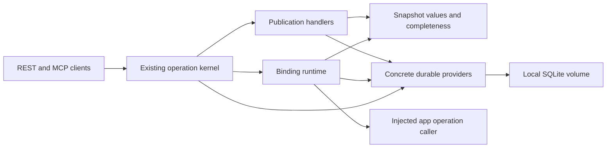

# Technical Design

## Overview

External producers publish complete replacement snapshots through the installed operation facade. The feature supplies exact typed read-back after restart and retained binding/run lifecycle for app integrations. Its first useful slice is publish, inspect, restart and inspect through ordinary REST/MCP; the complete feature additionally delivers pause/latest-resume and truthful recovery.

### Goals

- Preserve supplied schema, precision, provenance and producer order in immutable values.
- Implement concrete durable kernel providers and one-process runtime using existing contracts.
- Keep publication usable independently of report compilation and browser feasibility.

### Non-Goals

No financial calculations, dataframe/query engine, alternative backend, distributed scheduler, app driver, report compiler or export implementation.

## Boundary Commitments

### This Spec Owns

- `data`: immutable snapshot/schema/input-requirement values and pure validation/completeness rules.
- `runtime`: binding generations, run pins, cadence, lifecycle and conditional effect observations.
- `adapters/storage`: one concrete SQLAlchemy/SQLite implementation of retained publication/runtime state and all nine existing `GuaranteeProviders` obligations.
- Data-owned snapshot-read port, runtime-owned recovery and capability registration/composition for these operations; synchronized public example and quickstart.

### Out of Boundary

Kernel dispatch, access policy semantics, receipt state rules and retry admission contracts remain authoritative. This spec implements their providers, not replacements. Report-model owns extracting declared requirements and prepared content; GridCraft owns target inspection/mutation and controls; browser verification owns real browser/artifact evidence. Runtime records only independently evidenced app observations and cannot manufacture visible completion.

### Allowed Dependencies

Dependency direction: `contracts <- data values <- runtime <- adapters/storage <- composition`; the existing application kernel remains unchanged. Pure data values/requirements import stdlib/contracts only. The integration protocol `data.ports` alone may import exact `application.service_values.Missing`/`VersionConflict`/`ServiceUnavailable`; this does not grant other data modules application imports. Runtime imports stdlib/contracts/data plus exact existing application ports, capability/registration and outcome/CAS contracts; never reporting/themes/policies, concrete adapters or frameworks. Generic `contracts.pins.VersionPin(identity, version, content_digest)` is defined once by this spec and consumed by report-model; runtime stores a generic pack pin, while report-model owns its extra attribution/visibility metadata. Storage imports those values/ports and SQLAlchemy. Interfaces remain unchanged and call the facade. Composition injects explicit typed bundles through `settings.configure` and `open_application`; no global container.

### Revalidation Triggers

Snapshot wire/canonicalization changes revalidate report preparation and saved evidence. Input requirements, binding generations, RunPins, target identity or effect observation changes revalidate GridCraft and recovery clients. Storage schema, process topology, retention epoch or provider semantics changes revalidate installed kernel conformance and restart journeys. Pin shape changes require sibling sign-off before implementation.

## Architecture

### Existing Architecture Analysis

`OperationBinding`, `CommandContext`, `ReadContext`, `OutcomeProposal`, `ResourceRef`, `ExpectedVersion`, `StageResult` and `EvidenceRef` remain the typed path. The kernel owns accepted/pending/complete/partial/ambiguous/failed receipt transitions and result read-back. `GuaranteeProviders` names journal, guard, evidence, capabilities, resources, effects, results, handoffs and health. The access policy stays in the trusted `PrincipalBoundary`; production feed/resource ownership is read from storage by that policy. No permissive defaults are introduced.

### Technology Stack

| Layer | Choice / Version | Role | Constraint |
| --- | --- | --- | --- |
| Runtime | CPython >=3.12,<3.13; existing locked tools | Typed values, asyncio lifecycle | Record installed patch during task 1 |
| Boundaries | Existing Pydantic 2.14.1, FastAPI 0.143.0, MCP 2.3.0 | Strict codecs and existing transports | No new route protocol |
| Storage | SQLAlchemy Core 2.1.4 with stdlib sqlite3 | Library expressions, constraints and transactions | Resolve exact dependency lock first |
| Deployment | One host process, local file or Compose named volume | Durable shared provider state | No network filesystem, second process or alternate backend |

SQLAlchemy supports explicit Python 3.12 `autocommit=False`; transactions use `Engine.begin()`. Stored content is canonical bytes with exact decimal strings, not SQLite floating values. SQLite is selected for the bounded single-writer workload; PostgreSQL remains a future topology decision. No Polars conversion is needed for JSON publication. Official dependency findings and rejected alternatives are in [research.md](research.md).

## File Structure Plan

New files are proposals until gate task 1 passes. Files group by responsibility, not line-cap evasion; each module remains <=300 LLOC and functions <=50 LLOC/McCabe10.

| Component | Concrete paths | Change / owner |
| --- | --- | --- |
| VersionPin | `src/craftreport/contracts/pins.py` | New; contracts; shared immutable identity/version/content_digest |
| SnapshotValues | `src/craftreport/data/__init__.py`, `values.py`, `validation.py`, `requirements.py` | New; data |
| SnapshotReadPort | `src/craftreport/data/ports.py` | New; data; exact Missing/VersionConflict/ServiceUnavailable kernel value imports only |
| RecoveryUseCase | `src/craftreport/runtime/recovery.py` | New; runtime; existing outcome rules/CAS only |
| SnapshotCodecs | `src/craftreport/adapters/snapshot_wire.py` | New; adapters; reuse existing PydanticCodec |
| DurableSchema | `src/craftreport/adapters/storage/__init__.py`, `database.py`, `schema.py`, `serialization.py` | New; proposed most-specific snapshot-storage owner |
| DurableJournal | `src/craftreport/adapters/storage/journal.py` | New; snapshot-storage |
| DurableProviders | `src/craftreport/adapters/storage/guard.py`, `providers.py`, `results.py` | New; snapshot-storage |
| SnapshotStore | `src/craftreport/adapters/storage/snapshots.py` | New; snapshot-storage |
| BindingStore | `src/craftreport/adapters/storage/bindings.py` | New; snapshot-storage |
| PublicationOperations | `src/craftreport/runtime/publication.py` | New; runtime |
| BindingRuntime | `src/craftreport/runtime/__init__.py`, `values.py`, `ports.py`, `bindings.py`, `scheduler.py`, `capability.py` | New; runtime |
| DurableHost | `src/craftreport/composition/snapshot_host.py`; `pyproject.toml`, `uv.lock` | New assembly; explicit entry point; root coordinates shared files |
| ActivationGate | `scripts/check_imports.py`, `tests/engineering/test_boundary_gates.py`, `quality.toml`, `breadth.toml` | Modify exact owner/import scopes before source; root owns integration |
| Verification | `tests/snapshot_runtime/test_values.py`, `test_providers.py`, `test_publication.py`, `test_bindings.py`, `test_recovery.py`, `test_installed.py` | New; development-gates, tests reported separately |
| Adopter workflow | `scripts/examples/publish_and_recover_snapshot.py`, `scripts/examples/snapshot_demo_host.py`, `examples/data/snapshot_runtime.json`, `docs/quickstarts/Quickstart_How_to_publish_and_recover_a_snapshot.md`, `docs/quickstarts/index.md` | New recipe/fixture/guide and index update; exact declared owners before expansion |

Do not create all modules as scaffolding. Add files only with the task that supplies their working behavior. `snapshot_demo_host.py` is separate bootstrap, never imported by reusable caller functions.

## Components and Interfaces

| Component | Intent | Requirements | Critical dependencies / contracts |
| --- | --- | --- | --- |
| SnapshotValues | Exact immutable inputs and completeness | 1.1, 1.2, 1.3, 1.4, 1.5, 3.1 | Inbound publication/compiler P0; plain values |
| PublicationOperations / SnapshotStore | Ordered complete replacement acceptance | 2.1, 2.2, 2.3, 2.4, 2.5, 2.6 | Kernel P0; guard+store atomic effect |
| DurableJournal / DurableProviders | Nine concrete kernel guarantees | 5.1, 5.2, 5.5, 5.6, 5.7, 6.1, 6.2, 6.3 | SQLAlchemy P0; existing ports |
| BindingRuntime / BindingStore | Run pins, generation CAS, lifecycle | 3.2, 3.3, 3.4, 3.5, 4.1, 4.2, 4.3, 4.4, 4.5 | Immutable input requirements P0; app caller P0 |
| RecoveryUseCase | Inspect and reconcile without replay | 5.3, 5.4, 5.6 | Journal/outcome rules P0; app observer P0 |
| DurableHost / adopter workflow | Shared public path and actual proof | 6.1, 6.2, 6.3, 6.4, 6.5, 6.6 | Installed package P0; ordinary clients |

### SnapshotValues: service and state contract

All values are recursively frozen dataclasses with tuple containers. `SnapshotRef(feed_id: str, producer_version: int, content_digest: str)` identifies exact content. Feed identities are tenant/deployment-scoped resource identifiers, not caller filesystem paths.

- `Scalar = str | bool | int | Decimal | date | datetime | None`.
- `Field(name, label, kind, nullable, unit: str|None, precision: int|None, scale: int|None)`; kind is `text|bool|int64|decimal|date|datetime`.
- `Dataset(name, label, fields: tuple[Field,...], rows: tuple[tuple[Scalar,...],...], keys: tuple[str,...], source_ref: str, producer_id: str, source_version: str|None)`; label and source provenance are retained separately from technical name/feed version.
- `ImportedMetric(identity, unit, period: str|None, as_of: datetime|None, source_ref, producer_id, method_version, shape: Literal['scalar','series'], value_schema: Field, labels: tuple[str,...], values: tuple[Scalar,...], external_evidence: tuple[str,...])`. At least period or as_of is required; scalar has empty labels and one value; a series has equal label/value counts including zero and preserves label order. External refs remain claims, not CraftReport verification evidence.
- `Snapshot(schema_version: Literal['1'], feed_id, producer_version, content_digest, datasets, metrics, observation_time: datetime|None, generation_time: datetime|None, received_at, accepted_at)`.
- `FieldRequirement(name, kind, unit: str|None=None, nullable: bool=True)`; false requires a nonnullable source declaration and no null values.
- `DatasetRequirement(name, fields: tuple[FieldRequirement,...])`; `MetricRequirement(identity, unit: str|None=None, kinds: tuple[ScalarKind,...]=(), shape: Literal['scalar','series']|None=None, nullable: bool=True)`; `InputRequirements(datasets, metrics)`. Empty kinds means unrestricted; shape=None means scalar or series. A metric line-chart requirement declares kinds=(int64,decimal), shape=series; nullability false requires nonnullable schema and values. Dataset chart requirements carry explicit exact expected kind/unit/nullability from the definition: category text/date/datetime/int64 and nonnullable, series int64/decimal with nullable permitted for gaps. No current-snapshot inference is used to invent requirements.
- `BindingIssue(location: tuple[str|int,...], code)` codes: missing_dataset, missing_field, missing_metric, incompatible_type, incompatible_unit, incompatible_shape, nullability.
- `check_completeness(snapshot: Snapshot, requirements: InputRequirements) -> tuple[BindingIssue,...]` is pure; empty means complete. Accepted input may be incomplete for one binding but complete for another. It never imports a report compiler.

`data.ports.SnapshotReader` declares `async read(ref: SnapshotRef) -> Snapshot | Missing | VersionConflict | ServiceUnavailable`; handlers authorize its snapshot resource before use. Exact digest mismatch returns existing kernel VersionConflict with requested/authoritative digest pins for the exact snapshot ResourceRef, never another version. The data.ports exception permits that existing value as well as Missing/ServiceUnavailable. The report-model capability injects this port and calls the pure completeness function; it defines no alternate snapshot value. `SnapshotReadPort` is a feature-owned integration boundary, not a new dependency of the stable application kernel.

### Wire validation and canonical identity

JSON schema version is `1`; unknown properties are rejected. All wire int64 values are canonical signed decimal strings in signed64 range with bool excluded; producer versions are positive decimal strings representing 1..2^63-1. Inward values are Python int. This preserves the kernel canonical wire profile, which rejects JSON integer magnitudes above2^53-1. Decimal values are finite fixed-scale strings, precision1..38 and scale0..precision; no float or implicit rounding. Dates use ISO calendar dates; datetimes are offset-aware ISO8601 normalized to UTC microseconds. Strings remain text even with `=`, `+`, `-` or `@` prefixes. Duplicate dataset/field/metric names and invalid/duplicate declared keys fail with row/field locations; empty typed datasets are valid. Supported declared value rules are exactly type, nullability, declared keys and shape; unknown arbitrary/executable constraint fields are rejected. No rules engine, undeclared schema inference or financial calculation occurs.

Datetime lexical validation rejects more than six fractional-second digits before parsing, including when a standard parser would silently truncate; this profile advertises microsecond precision only. Naive timestamps, invalid offsets and leap-second representations are rejected. Dataset label/source_ref/producer_id/source_version roundtrip checks are independent of metric provenance checks.

`adapters.snapshot_wire.encode_scalar(value: Scalar) -> JsonValue` encodes int/Decimal/date/datetime as exact strings, text unchanged, bool/null literally. `decode_scalar(value: JsonValue, field: Field) -> Scalar` validates against explicit schema and does not infer. These are reused by report codecs, not reimplemented. Generic resolved parameters carry a tagged scalar envelope `{"kind":...,"value":...}` at persistence/wire boundaries so a string, integer and decimal remain distinguishable without loading a compiler; inward RunPins keeps typed Scalar values. No JSON numeric value is used to carry int64 data.

Canonical producer content includes schema version, feed/version, full ordered schema/data/metrics/provenance and producer timing fields. UTF-8 JSON uses sorted object keys, compact separators and original array order. Decimal lexical alternatives normalize losslessly to declared scale, signed zero to zero. Service received/accepted times, retry identity and operation ID are excluded. SHA-256 produces content_digest. Store canonical bytes plus the digest and verify both on read; corrupt content is unavailable, never regenerated. Different service receipt times do not turn an equivalent retry into different producer content.

Advertised defaults: 1 MiB decoded input/output, nesting depth32 (kernel limits), <=16 datasets, <=128 fields/dataset, <=10,000 total rows, <=100,000 total cells, <=128 metrics and <=10,000 total metric points, each string <=4,096 code points. Metadata and values share the byte cap. The request codec computes the full canonical snapshot.read result size using fixed maximum-length service timestamps and64-character digest placeholders before command admission; service-generated fields have closed formats and no unbounded diagnostic payload. Reject any publication that cannot fit that result descriptor cap with its affected named limit before accepting work, not merely before effect commit. Actual readback checks exact serialized result bytes again as defense against defects. Limits are configured downward only in this first implementation; any supported increase requires design/calibration review.

### PublicationOperations: API contract

Existing `POST /v1/invoke` and registry-derived MCP tools such as `snapshot.publish.v1` carry `InvocationEnvelope`; discovery and built-in `craftreport.inspect.v1`/`craftreport.result.v1` remain existing kernel paths. Operation names below use contract version `1` and do not encode versions into names. Authoritative resource identities are `ResourceRef("feed", feed_id)`, `ResourceRef("snapshot", feed_id+":"+version)` and binding/run kinds. Publication declares the feed resource only, so a new immutable snapshot does not require a fabricated pre-existing resource. Binding creation uses an authorized absent resource with version token `absent`; persisted revisions use decimal integer strings. Missing content read is still Missing, distinct from the authoritative creation precondition. Tenant/deployment scope comes from trusted principal/configuration, never request override.

| Operation | Kind / request | Result / required effect |
| --- | --- | --- |
| `snapshot.publish` | Command; complete schema-tagged replacement | SnapshotRef, schema counts, times/findings; `snapshot_persisted` evidence read from committed bytes |
| `snapshot.read` | Query; SnapshotRef | Exact Snapshot or missing/unavailable/conflict |
| `snapshot.latest` | Query; feed_id and optional InputRequirements | Latest accepted ref and highest complete ref plus incomplete diagnostics |
| `runtime.bind` | Command; immutable binding specification, expected generation | Binding state/generation; persisted read-back evidence |
| `runtime.control` | Command; binding_id, action start/pause/resume/stop, expected generation | Retained lifecycle intent; successful command means control persisted, not app applied |
| `runtime.inspect` | Query; binding_id or run_id | Accepted/complete/selected/applied references and stage history |
| `runtime.reconcile` | Command; original operation/run, expected binding generation | Inspection outcome and new reconciliation reference; no blind target mutation |

Before feed acceptance, `guard.assert_current()` runs; commit holds the one storage mutex and checks feed high-water again. Unique `(deployment, feed, producer_version)` plus feed revision CAS serializes acceptance. Existing same-version/digest returns the existing snapshot; different digest conflicts; unseen lower version is stale. Kernel retry lookup occurs before new effect admission and retains its original receipt even after later feed versions exist. Rejected business decisions return typed result status and `EffectDisposition.NONE`, never fake persistence evidence. Validation errors before admission are Rejection; receipt stages distinguish command completion from business acceptance.

### DurableSchema and concrete provider contract

One OS lock beside the configured database rejects a second host for the lifetime; the OS releases it after process death. Async provider calls run a short synchronous SQLAlchemy transaction via `asyncio.to_thread`, with a process-wide mutex and per-call connection. Default SQLite rollback journal/synchronous FULL and foreign keys ON are verified at open. Only fixed PRAGMA initialization text is allowed in database.py. No SQL transaction spans app I/O or awaits. SQLite file corruption, unknown schema, lock timeout and uncertain commit acknowledgement return unavailable; no fallback database is created over existing state.

| Table | Key / retained purpose |
| --- | --- |
| `deployment` | fixed identity, schema_version=1, retention profile/epoch, configured limits |
| `commands` | operation_id PK; unique deployment/subject/operation/version/retry_key; canonical intent, current revision/receipt |
| `observations` | operation_id+revision PK; append-only approved stage/evidence/receipt update |
| `results` | opaque ref PK, deployment/subject/operation_id, exact canonical result bytes/digest |
| `evidence` | opaque identity PK, exact EvidenceRef and verified committed fact bytes |
| `handoffs` | operation_id+ref PK, exact trusted RecordedHandoff including owner/versions |
| `feeds` | deployment+feed PK, high-water version and resource revision |
| `snapshots` | deployment+feed+producer_version PK, digest, canonical bytes, operation_id, distinct times |
| `bindings` | binding_id PK, generation, immutable spec, lifecycle intent/recovery state, selected/applied refs |
| `runs` | run_id PK, immutable pins, binding/generation and append-only observed effect references |

Foreign keys connect observations/results/handoffs to commands and runs to snapshots/bindings; no cascading deletion erases evidence. The default retention profile retains all committed content and retry identities until an explicit operator offline purge. Purge operates with host stopped, preserves identity/high-water tombstones and epoch, lists affected references and never makes an old retry safe to re-execute. Online arbitrary TTL deletion is excluded. Inspection distinguishes tombstoned Missing from I/O Unavailable. Capacity exhaustion reports unavailable/limit exceeded before replacing retained content.

| Existing provider | Concrete obligation |
| --- | --- |
| OperationJournal | Atomic admit with unique retry key/intent; immutable initial receipt; CAS append/update and exact readback; record_query audit |
| ExecutionGuard | Deterministically ordered per-resource asyncio locks; expected versions checked from storage under lease, checked immediately before effects; one-process fence only; cancellation releases locks |
| EvidenceReader | Exact opaque ref, operation/version pins, retained digest and availability; no fabricated/regenerated evidence |
| CapabilityResolver | Exact installed manifests/version/mode allowlist; missing unsupported; health failure unavailable |
| ResourceReader | Feed/snapshot/binding/run current resource versions/content from store; no business work. Report-model composition supplies immutable pack-source/artifact-scope observations and delegates storage kinds here; storage never invents pack state |
| ResourceEffects | Only capability-validated snapshot/binding changes; atomic operation-linked committed fact; unknown changes rejected; app effects remain app-owned |
| ResultStore | Trusted deployment/subject/operation ownership; immutable exact bytes and real readback |
| HandoffStore | Exact fenced ownership records; never infer liveness from old owner strings |
| ServiceHealth | Actual small storage/read/integrity/configured capability observations; configured service names only |

`PrincipalBoundary` checks resource and receipt ownership against retained trusted identities before protected reads. Feed creation requires deployment-configured grant; bindings cannot claim another caller's target. Providers never accept a caller-supplied tenant, user or database path.

For real report preparation, task 3.3 exposes only trusted `retain_preparation_fact(reference: EvidenceRef, canonical_fact: JsonObject) -> EvidenceRef | ServiceUnavailable` in existing storage results/evidence code, with no public operation or ordinary CommandContext writer. The report adapter creates the typed fact and converts to generic kernel values; storage imports no reporting/theme/policy modules. Retention accepts only the closed preparation scope/stage schema (`prepared` or `quality_evaluated`, bounded check/decision data <=16 KiB, no source rows or executable fields), verifies reference operation ID/key against the retained command, derives trusted deployment/subject ownership, and exclusively writes the existing evidence table. Before return it independently rereads canonical bytes, digest, exact ref and the full declared resource/version set, including report-owned pins already observed by reporting composition. Existing EvidenceReader verifies those same retained facts after restart without regenerating them; it verifies trustworthy retained observation bytes, not an invented passed quality result. Missing, corrupt, inaccessible or unavailable facts remain distinct and cannot complete preparation. This extends the existing evidence retention obligation, adding no table, second journal, completion authority or provider framework; application source and existing caps remain unchanged.

### BindingRuntime: service, job and state contract

The binding specification stores feed_id, immutable InputRequirements/digest, definition/template/theme/pack `VersionPin` values, resolved typed parameters as `tuple[tuple[str, Scalar],...]` in declaration order and their digest, validation_scope and `TargetIdentity(adapter_id, mode, session_id, document_id)`. It does not carry forward a previous snapshot's prepared digest as current content. Runs copy the newly prepared pins and snapshot ref once; later publications cannot mutate them. `RunPins(run_id, binding_id, binding_generation, snapshot:SnapshotRef, definition, template, theme, pack:VersionPin, resolved_parameters, parameter_digest, validation_scope, prepared_operation_id, prepared_result_ref, prepared_digest, target:TargetIdentity)` is the exact runtime-owned retained value seam. Target mode is a closed supported native/browser/headless value and session/document identity is mandatory even for synthetic fixtures.

`runtime.ports` defines `RuntimeStore` methods load/save_binding(expected_generation), select_run(expected_generation,snapshot,pins), observe_effect(expected_generation,run_id,observation) and list_recoverable; each returns immutable success/conflict/missing/unavailable unions. `RunPreparer.prepare(binding: BindingSpec, snapshot: SnapshotRef) -> PreparedRunInputs | PreparationIssue | ServiceUnavailable` is a generic app-composition-owned injected collaborator; a real reporting integration calls public `reports.prepare`. It returns exact snapshot, generic definition/template/theme/pack pins, resolved parameters/digest, validation scope and retained prepared operation/result reference/digest. No PreparedReport/compiler type crosses into runtime. The runtime verifies returned snapshot/digests/pins against selected input and binding, rereads current generation, lifecycle revision and running intent after preparation, and only then commits immutable RunPins and calls AppOperationCaller.start under the lifecycle start fence described below. Preparation failure, changed generation, pause or stop starts no target effect. Preparation reserves the binding's one in-flight slot; later ticks coalesce rather than overlap preparation. `AppOperationCaller.start(run: RunPins) -> str`, `inspect(operation_id: str) -> EffectObservation` and `cancel(operation_id: str) -> CancellationObservation` are explicit injected collaborators. App integration supplies these typed implementations through existing facade operations. It cannot directly advance a binding.

The per-binding lifecycle start fence is a local asyncio serialization point, distinct from the short selection SQL transaction and every kernel resource lease. Preparation awaits outside it. Within it, recheck running intent/generation/lifecycle revision, commit the selected RunPins in a short transaction, release that transaction and any selection kernel lease, then invoke `start` and retain its operation-ID handoff. `start` uses actual bounded Facade.invoke semantics (complete or accepted/pending response), not a new admission-only API; release the fence before inspect/polling or waiting for app completion. App start declares the immutable run and its required input/app resources, never the mutable binding resource lease: runtime.control may already hold that lease while waiting for the lifecycle fence, so acquiring it in nested app admission would invert locks. Pause/stop serialize their intent transition on this same fence. If pause wins, subsequent recheck prevents start; if start wins, that admitted/uncertain operation is already in flight and pause exposes pause_pending until it resolves, preventing later starts. A pause waiting behind the bounded start handoff is pending, not acknowledged paused. Rejection or start exception releases the fence and retains a failed or ambiguous admission observation as appropriate; lost acknowledgement uses the same deterministic retry identity for inspection/reconciliation, never a blind replay. No SQL transaction or kernel resource lease spans a nested facade invocation.

Standalone runtime lifecycle verification does not depend on the report-model implementation. It injects a clearly synthetic RunPreparer that retains a fixture prepared result using the real durable ResultStore and an effect collaborator whose local durable output is independently read back. These collaborators establish runtime pins/control/recovery only and cannot establish real report preparation, browser or XLSX acceptance. The composed reporting journey later replaces them with real reports.prepare/app operations without changing runtime contracts.

`EffectObservation(run_id, target, binding_generation, effect: EffectDisposition, stages: tuple[StageResult,...], evidence: tuple[EvidenceRef,...], verified_complete: bool)` is trusted only after provider verification of exact app/session/document/run/version evidence. Wire callers cannot assert verified_complete. Applied advancement requires complete verified observation, matching generation/selected run/target and current resource CAS. An older completion becomes historical conflict; partial/unknown never advances applied. Preserve last successfully applied reference separately from current target freshness.

One asyncio loop owns cadence. Initial selection and resume select immediately; subsequent ticks use monotonic time with default10s. At most one in-flight update per binding; ticks coalesce to highest complete feed version. Incomplete latest accepted versions remain inspectable while an earlier complete version is selected. Locks cover selection/CAS only. Pause immediately prevents new starts and exposes pause_pending until the current effect resolves; an already-started effect may complete but must satisfy unchanged generation/CAS. Paused state retains partial/ambiguous error observations. Stop increments generation, stops scheduling until explicit start, requests cancellation and preserves observed unknown/partial effects. Definition/feed/target/pin/input changes increment generation; pause/resume alone changes lifecycle revision without invalidating a pinned in-flight run. ExpectedVersion carries resource revision; binding generation is a separate business field. Inspection exposes intent, recovery_required, last attempt/completion times, latest complete accepted and last complete applied refs/times, pending operation and last error. App-owned freshness classification consumes these facts and the declared threshold; this feature does not add a competing freshness policy.

Shutdown first stops new scheduling, joins/cancels owned jobs within configured kernel shutdown grace and records unknown in-flight effects. Restart restores intent but sets active bindings `recovery_required`; paused/stopped remain paused/stopped. No app work starts until an explicit authorized resume/reconcile verifies current target/session/document and supported capabilities. Missing/replaced target remains unavailable. This is not a durable timer queue or distributed lease.

### RecoveryUseCase: trusted service contract

Snapshot effect commit, result storage and final journal observation are separate transactions because the existing kernel sequences them. Every committed effect records its original operation_id and exact pins, permitting deterministic inspection after any cutpoint. Startup enumerates nonterminal journal records via a narrow provider recovery reader. Orphan ACCEPTED/PENDING receipts receive an append-only ambiguous observation through existing journal CAS; lost admission acknowledgement is looked up by its scoped retry identity before any effect.

The runtime-owned trusted reconciler inspects committed facts and external state, builds fresh `EvidenceRef(scope="reconciliation", operation_id=original, operation=original_key, resource_versions=observed_versions)` and calls existing application `outcome_update` with `OutcomeFacts.reconciliation`, result readback and CAS/readback. It does not run the original handler. For a committed snapshot, exact stored bytes establish application; for absent local effect, known absence permits failed reconciliation; for external uncertainty it stays ambiguous. Original COMPLETE/PARTIAL/FAILED receipts remain terminal; a later recovery action has its own operation and links preceding evidence, without rewriting that history. Access precedes recovery enumeration/read. Recovery writers are injected only into this trusted runtime recovery use case, never exposed in CommandContext or ordinary capability handlers. This adds no journal/dispatch/state-rule implementation to the stable application kernel.

## Error Handling

Codecs raise existing WireFailure with safe locations for invalid_type, precision, shape/key violations and applicable limits. Business publication result codes include accepted, existing, stale_version, version_conflict and incomplete_binding. Protected diagnostics obey existing kernel sanitization. Provider I/O failures return ServiceUnavailable or the existing mandated exception, never Missing. Unknown effect means inspect/reconcile; deterministic invalid requests require correction. Logs retain correlation/operation/run/resource identities without raw private rows or credentials.

## Testing Strategy

- Values: 1.1–1.6 exact signed64 strings/Decimal38 scale, bool/int rejection, UTC/date, formula-like strings, null/key failures, ordering and canonical equivalence/difference; independently fixed expected decimals and bytes.
- Store/provider integration: 2.1–2.6, 5.1–5.2, 5.5–5.7 unique races, CAS history, cross-subject denial, health failures, corruption/missing distinction, actual file reopen and second-host rejection. Use real SQLAlchemy SQLite, not an in-memory stand-in for durability.
- Installed first slice: REST publication -> exact result/snapshot read -> stop host -> reopen same isolated database with same deployment epoch -> MCP exact read and retry; observe bytes/digests and SQLAlchemy query readback. Repeat with postcommit/pre-receipt crash and show one acceptance.
- Runtime: 3.1–3.5, 4.1–4.5 deterministic clock tests plus one real10s tick smoke; incomplete newest input, pause publications/resume highest complete, in-flight coalescing, stale completion, target replacement and stop cancellation. Synthetic adapter has a real independently inspected local durable effect, not a mocked success.
- Recovery: 5.3–5.6, 6.5 crash before/after app effect and before acknowledgement; restart remains suspended/ambiguous, no duplicate mutation; independent inspection resolves exact original run and retains prior evidence. Browser effects remain downstream acceptance.
- Adoption: 6.1–6.6 run reusable ordinary REST/MCP recipe with AI disabled, follow guide in clean installed environment, validate expected results and bounded owned cleanup. Record source/dependency/host/storage identities, commands/exit codes/receipts and limitations under ignored `artifacts/snapshot-runtime/<run>`.

## Interaction and Verification Contract

Canonical content is stored snapshot bytes; canonical operation history is the existing journal; binding/run state belongs to runtime store; app state belongs to the app. Selected/applied summaries derive from those records and never overwrite evidence. A completed publication/control receipt proves its declared durable effect only. App applied, artifact persisted and artifact reopened remain separate stages.

The first reference path uses a project-isolated installed host and local database with ordinary clients. No browser is required or claimed. Later GridCraft integration supplies exact adapter/mode/session/document identity and browser evidence. `uv.exe run --frozen python scripts/check.py --fast` and `--integration` remain canonical; add focused `tests/snapshot_runtime` checks and installed runtime journey to the approved integration entry point. No runtime execution is claimed by this design.

Gate task applies default1,500 LLOC to data/runtime and a most-specific snapshot-storage owner; existing application/adapters/composition aggregate caps stay unchanged. Measured application baseline is1,449/1,500 LLOC; no new application source is planned. Proportional first-slice estimates are data450, runtime publication/registration250 and snapshot-storage950 LLOC, with full runtime values/scheduler/recovery targeted within its existing1,500 cap. These estimates are not acceptance or permission to exceed limits; review measured first-slice size and simplify before adding later lifecycle work. Example/bootstrap executable ownership and typed scope are explicit. The exact new import rules allow only reviewed dependencies; negative fixtures forbid storage/framework imports into data/runtime and report compiler imports into publication. Root coordinates shared quality/ledger edits with sibling specs before new source. No numeric limit increase or browser gate waiver is authorized.

## Requirements Traceability

| Requirement | Summary | Components | Interfaces | Flows |
| --- | --- | --- | --- | --- |
| 1.1, 1.2, 1.3, 1.4, 1.5, 1.6 | Typed faithful input and limits | SnapshotValues, SnapshotCodecs | snapshot.publish/read | validation/canonical roundtrip |
| 2.1, 2.2, 2.3, 2.4, 2.5, 2.6 | Immutable order and retry | SnapshotStore, DurableJournal, guard | snapshot.publish/latest | concurrency and restart |
| 3.1, 3.2, 3.3, 3.4, 3.5 | Completeness, pins and CAS | SnapshotValues, BindingRuntime, BindingStore | runtime.bind/inspect | select/effect observation |
| 4.1, 4.2, 4.3, 4.4, 4.5, 4.6 | Cadence and lifecycle | BindingRuntime scheduler | runtime.control | pause/latest resume/stop |
| 5.1, 5.2, 5.3, 5.4, 5.5, 5.6, 5.7 | Persistence and honest recovery | DurableProviders, RecoveryUseCase | read/inspect/reconcile | startup and cutpoint recovery |
| 6.1, 6.2, 6.3, 6.4, 6.5, 6.6 | Shared access and adopter proof | DurableHost, workflow | REST/MCP existing facade | installed guide/example |
